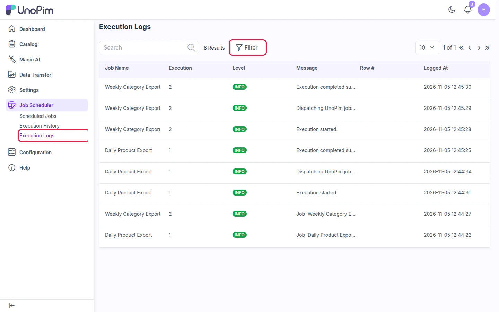

# Execution Logs

This page shows log messages from every run in one list. Check it when a job doesn't behave as expected.

Go to **Job Scheduler → Execution Logs**.

| Column | Meaning |
|---|---|
| **Job Name** | The job that wrote the log |
| **Execution** | The run ID. It matches the ID in **Execution History**. |
| **Level** | **INFO** for normal steps. **WARNING** or **ERROR** point to problems. |
| **Message** | What happened, e.g. *Execution started* or *Execution completed successfully* |
| **Row #** | The record row the message refers to (for errors on a single row) |
| **Logged At** | When the message was logged |

> **Tip:** Click **Filter** to show only one job, one run, or only errors.
