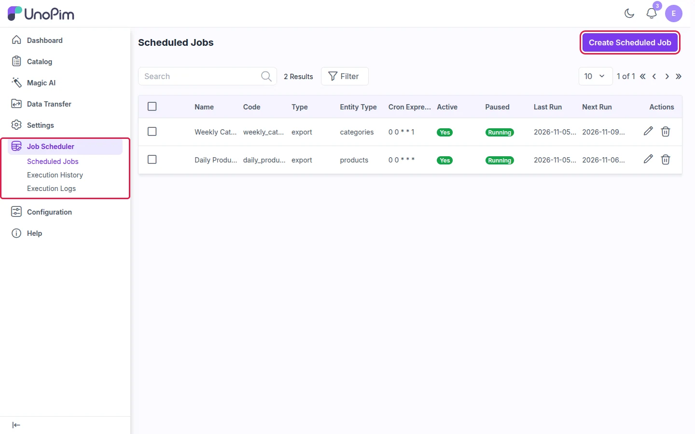

# Installation

You need terminal access to your UnoPim server.

---

## Step 1: Add the Package

Copy the extension to:

```
packages/Webkul/JobScheduler/
```

In your root `composer.json`, add this under `autoload → psr-4`:

```json
"Webkul\\JobScheduler\\": "packages/Webkul/JobScheduler/src"
```

---

## Step 2: Register the Providers

In `bootstrap/providers.php`, add:

```php
Webkul\JobScheduler\Providers\JobSchedulerServiceProvider::class,
```

In `config/concord.php`, add this to the `modules` array:

```php
Webkul\JobScheduler\Providers\ModuleServiceProvider::class,
```

---

## Step 3: Run the Installer

```bash
composer dump-autoload
php artisan job-scheduler:install
```

This creates the database tables the scheduler needs.

---

## Step 4: Add the Cron Entry

Open the crontab with `crontab -e` and add **one** line. Replace the path with your UnoPim folder:

```bash
* * * * * cd /path/to/unopim && php artisan schedule:run >> /dev/null 2>&1
```

This checks every minute whether a job is due. You don't need a separate cron line for each job.

---

## Step 5: Start the Queue Worker

Scheduled jobs run on the `job-scheduler` queue, so a worker must be running:

```bash
php artisan queue:work --queue=job-scheduler,default
```

> **Production tip:** Run the worker with **Supervisor** so it restarts automatically after a crash or a server reboot:
>
> ```ini
> [program:job-scheduler-worker]
> command=php /path/to/unopim/artisan queue:work --queue=job-scheduler,default --sleep=3 --tries=3 --max-time=3600
> autostart=true
> autorestart=true
> numprocs=1
> stdout_logfile=/path/to/unopim/storage/logs/job-scheduler-worker.log
> ```
>
> Then run `sudo supervisorctl reread && sudo supervisorctl update`.

---

## Check the Installation

Log in to UnoPim. You should see **Job Scheduler** in the left sidebar, with **Scheduled Jobs**, **Execution History** and **Execution Logs** under it.



**Next:** [Create your first scheduled job →](./setup)
