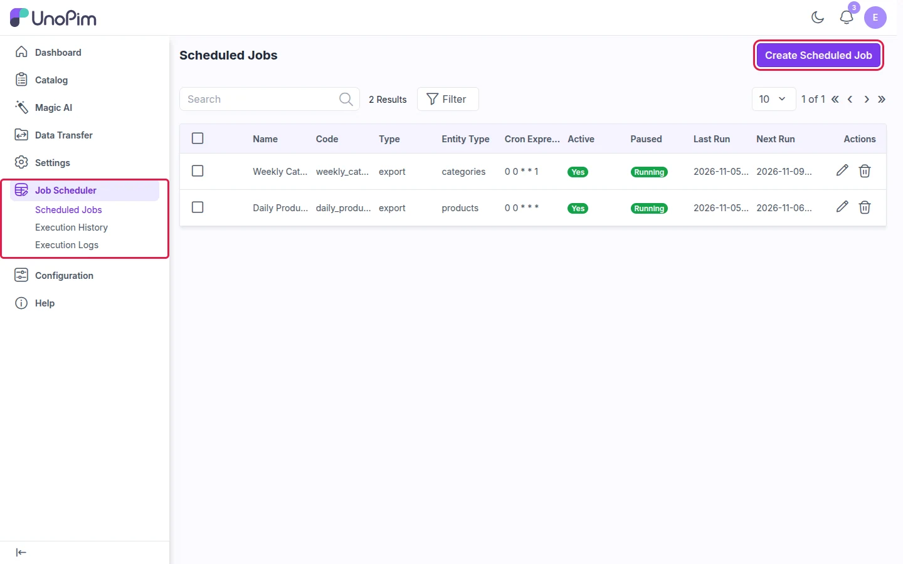
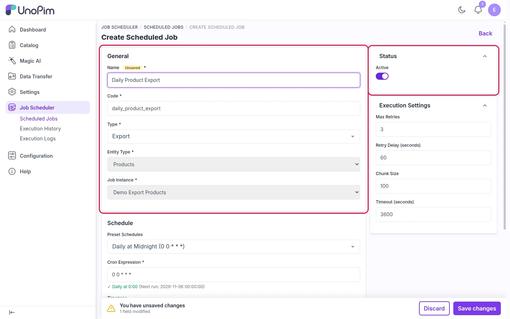
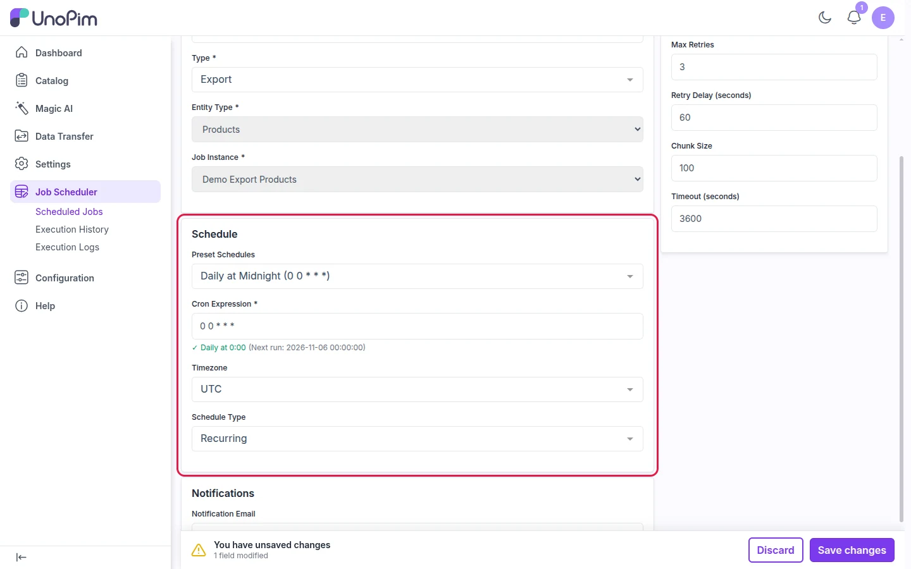
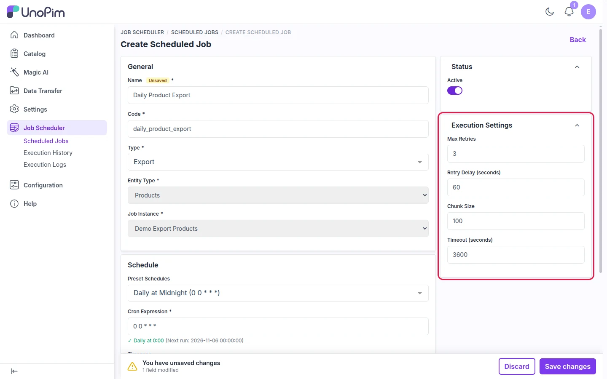
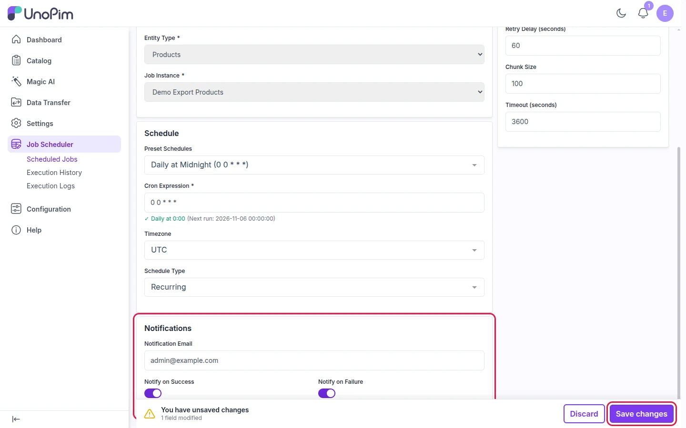

# Create a Scheduled Job

A scheduled job runs one of your existing UnoPim **Import** or **Export** profiles automatically, at the time you choose.

> **Before you start:** Create the import or export profile under **Data Transfer → Imports / Exports** first. The scheduler only lets you pick profiles that already exist.

---

## Step 1: Open the Scheduler

In the left sidebar, click **Job Scheduler → Scheduled Jobs**, then click **Create Scheduled Job**.

---

## Step 2: General Details

Tell the scheduler **which** job to run.

| Field | What to enter |
|---|---|
| **Name** | A clear name, e.g. `Daily Product Export` |
| **Code** | Filled in automatically from the name |
| **Type** | **Import** or **Export** |
| **Entity Type** | The data to process, e.g. **Products** or **Categories** |
| **Job Instance** | The import or export profile to run |
| **Status → Active** | Keep it on so the job runs. Turn it off to pause the job without deleting it. |

---

## Step 3: Set the Schedule

Tell the scheduler **when** to run the job.

| Field | What to enter |
|---|---|
| **Preset Schedules** | Pick a ready-made timing, such as *Hourly*, *Daily at Midnight* or *Weekly on Monday*. To set your own, choose **Custom**. |
| **Cron Expression** | Filled in from the preset. With **Custom**, type your own (e.g. `0 6 * * *` = every day at 6 AM). Below the field, you'll see the time of the next run. |
| **Timezone** | The timezone the schedule follows |
| **Schedule Type** | **Recurring** runs again and again. **One-Time** runs only once. |

> **Tip:** Not sure about cron? Pick a preset. Check the green line under the field: it shows when the job will run next.

---

## Step 4: Execution Settings (Optional)

The default values work for most stores. Change them only if you need to.

| Field | What it does |
|---|---|
| **Max Retries** | How many times a failed run is retried |
| **Retry Delay (seconds)** | Wait time before each retry |
| **Chunk Size** | Records processed per batch. Lower it for very large catalogs. |
| **Timeout (seconds)** | The longest a run may take before it is stopped |

---

## Step 5: Notifications and Save

Enter an email address, then choose whether to get an email when a job **succeeds**, **fails**, or both. Then click **Save changes**.

That's it. The job now runs on its own at the scheduled time. To edit, pause or delete it, use the **Scheduled Jobs** list.
