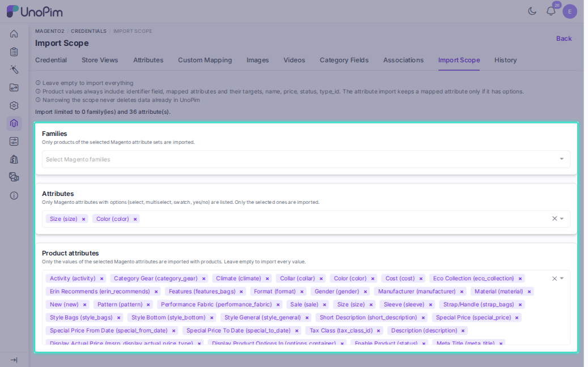

# Import Scope

The **Import Scope** tab limits what the Magento imports bring into UnoPim. Pick the attribute families and attributes you need, and the import ignores the rest.

Open it from **Magento2 > Credentials**, click a credential, then choose **Import Scope**.

> [!NOTE]
> The tab is covered by the **Attribute Mapping** permission. A user without it sees the tab read-only: "You do not have permission to change the import scope."

## The Three Lists

| List | What it limits |
|---|---|
| **Families** | Only products of the selected Magento attribute sets are imported. |
| **Attributes** | Only the selected Magento attributes are imported by the [attribute import](./import-attribute). The list shows attributes with options only: select, multiselect, swatch, and yes/no. |
| **Product attributes** | Only the values of the selected Magento attributes are imported with products. The list holds every attribute except fields the product import never reads, such as images, categories, and timestamps. |

The lists load from Magento when you open a dropdown. Saved selections show by name without calling Magento. If Magento cannot be reached, the list shows an error with a **Retry** button. Check the credential, then retry.

Click **Save** when you are done. A summary line shows the result, for example "Import limited to 2 family(ies) and 5 attribute(s)".

## Rules

- **Empty means everything.** With no selection in a list, nothing is limited.
- **Narrowing never deletes data.** Values already in UnoPim stay when you reduce the scope.
- **Always imported.** Product values always include the identifier field, the mapped attributes and their targets, `name`, `price`, `status`, and `type_id`. The attribute import keeps a mapped attribute only if it has options.
- **Families outside the scope are not imported.** The attribute set, attribute group, and attribute mapping jobs leave them out. The product jobs skip a product whose family is not imported in UnoPim, and the job log says so. To stop fetching other products from Magento at all, switch on **Import family specific products**.
- **Product attributes win.** When you pick **Product attributes**, they decide which values come with a product. Without a pick, the product import follows **Attributes**. If both are empty, the selected families narrow the attributes. With no families either, every value is imported.

## Import Only Some Families

1. Select the families on the **Import Scope** tab and save.
2. Create the product import jobs and switch on **Import family specific products**. See [Import Magento Product](./import-product#product-job-switches).

With the switch off, or while none of the selected families is imported yet, the job fetches the products of every attribute set.

## Tips

- Run the [attribute set import](./import-attribute) first, so the families you want exist in UnoPim.
- Pick **Product attributes** when you need a system field such as `special_price` without importing it as an attribute.
- Widen the scope and re-run the job to bring in more data. Nothing already imported is touched unless the job is set to **Overwrite**.
