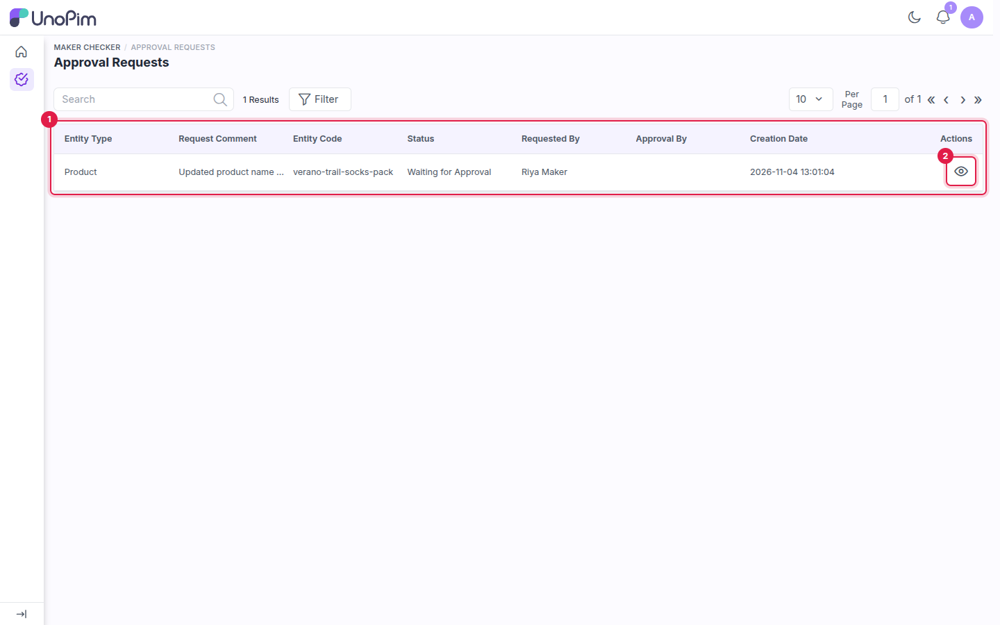
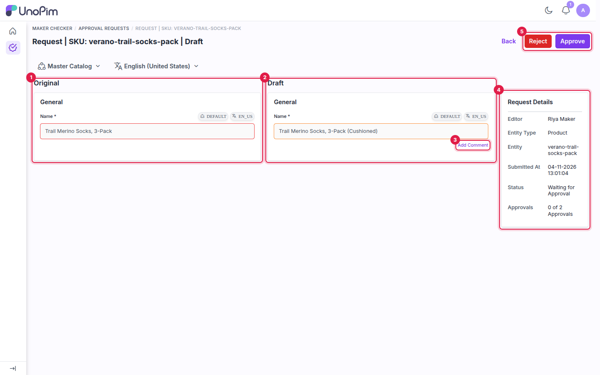
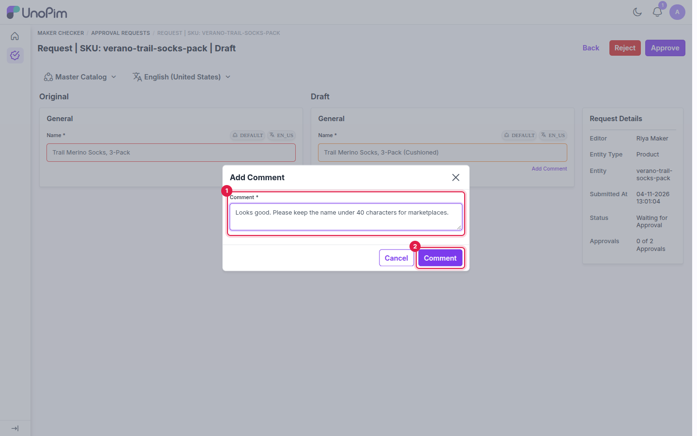
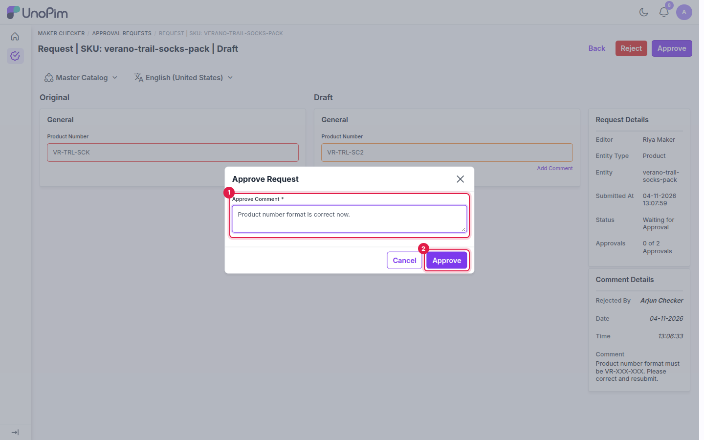
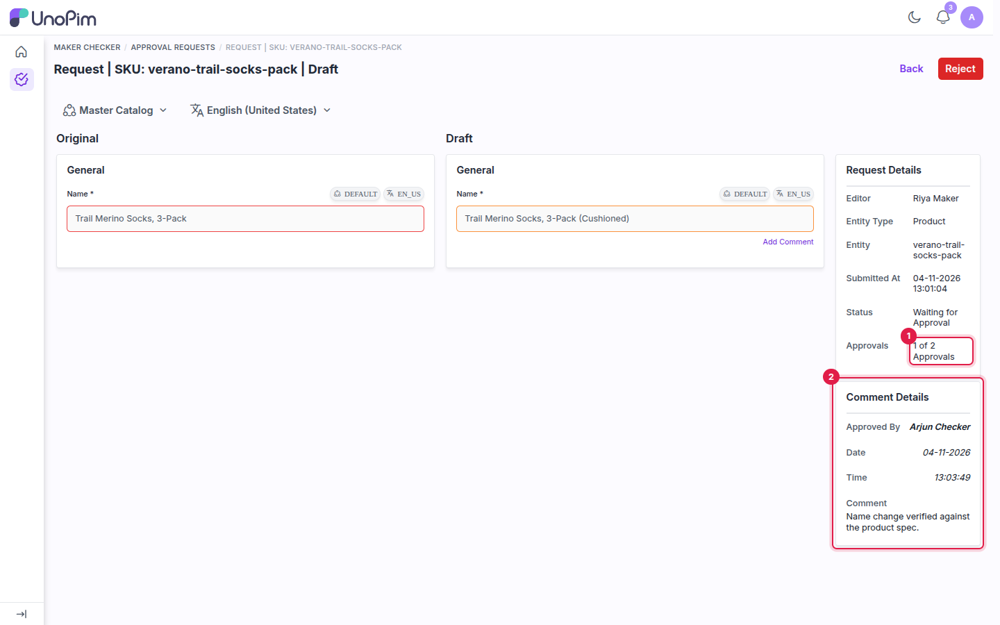
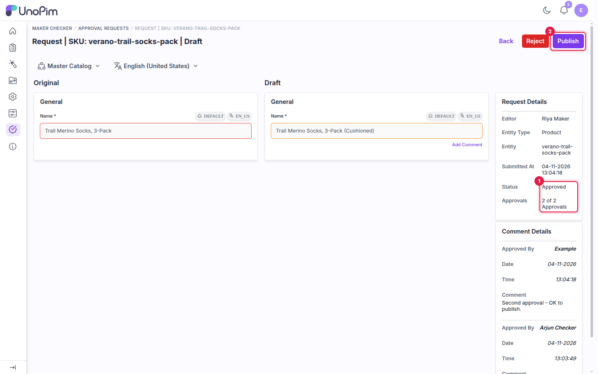
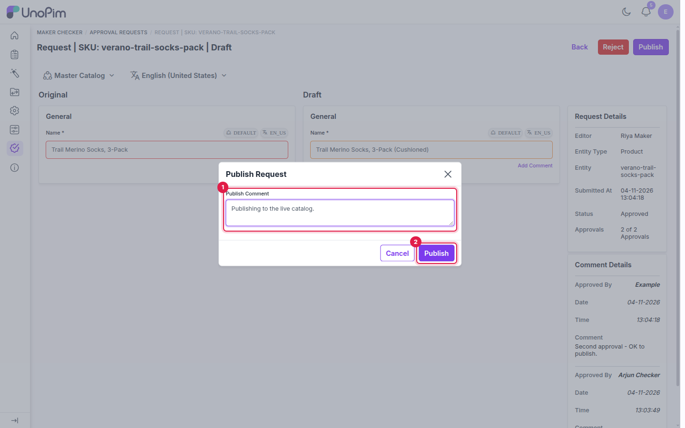

# Checker: Review and Approve

This page covers the checker's side of the workflow: finding open requests, comparing the changes, and approving and publishing them.

---

## Step 1 - Open Approval Requests

Go to **Maker Checker → Approval Requests**. The list shows every draft that's waiting for a decision.

1. The requests grid.
2. The **view** icon opens a request.

| Column | Description |
|---|---|
| **Entity Type** | **Product** or **Asset**. |
| **Request Comment** | The comment the maker entered when sending the draft. |
| **Entity Code** | The product SKU or the asset's identifier. |
| **Status** | The current stage, for example **Waiting for Approval** or **Approved**. |
| **Requested By** | The maker who sent the request. |
| **Approval By** | Who has approved it so far. |
| **Creation Date** | When the request was sent. |

Use **Search** and **Filter** to narrow the list. Once a draft is published, its request leaves this list.

## Step 2 - Review the changes

Click the view icon. The request page shows only the attributes that changed, with the live value next to the draft value.

| # | Area | Description |
|---|---|---|
| 1 | **Original** | The value currently live on the product. |
| 2 | **Draft** | The maker's proposed value. |
| 3 | **Add Comment** | Leaves a comment on this field for the maker. |
| 4 | **Request Details** | Editor, entity type, entity, submission time, status and approvals so far (for example, *0 of 2 Approvals*). |
| 5 | **Reject / Approve** | Actions available to your role. |

Use the channel and locale switchers above the comparison to check channel- or locale-specific values.

### Comment on a field

Click **Add Comment** under a draft field, enter your comment and click **Comment**. UnoPim shows *Comments saved successfully*, and the maker is notified. Commenting doesn't change the request's status.

1. **Comment**: your note about this field.
2. **Comment**: saves it and notifies the maker.

## Step 3 - Approve the draft

1. Click **Approve**.
2. Enter an **Approve Comment**. It's required.
3. Click **Approve** in the dialog.

1. **Approve Comment**: why you're approving.
2. **Approve**: records your approval.

UnoPim shows *Product draft Approved Successfully*. Your approval is added to **Comment Details**, and the approval count goes up. You can approve each draft only once, so the **Approve** button disappears for you afterwards.

If more approvals are needed, the status stays **Waiting for Approval** until enough other approval users approve it.

1. **Approvals**: *1 of 2 Approvals*, so one more approval is needed.
2. **Comment Details**: who approved it, when, and their comment.

When the count reaches the **Minimum Approval Required**, the status changes to **Approved** and the **Publish** button appears.

1. **Status**: **Approved**, with *2 of 2 Approvals*.
2. **Publish**: now available to users with the Publish permission.

## Step 4 - Publish the draft

1. Click **Publish**.
2. Optionally enter a **Publish Comment**.
3. Click **Publish** in the dialog.

1. **Publish Comment**: an optional note.
2. **Publish**: applies the draft to the live product.

UnoPim shows *Product draft Published Successfully*. The draft values replace the live values, the request leaves **Approval Requests**, and the maker is notified. The product's tracker returns to **Published**.

## What's next

- [Reject a draft and send it back to the maker](./reject-and-resubmit).
- [See which notifications each action sends](./notifications).
