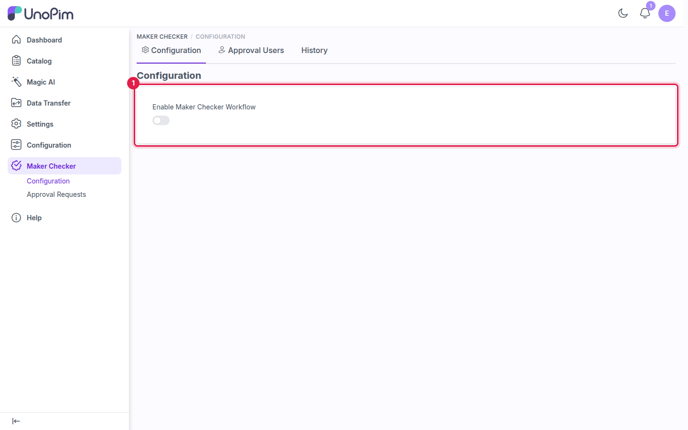
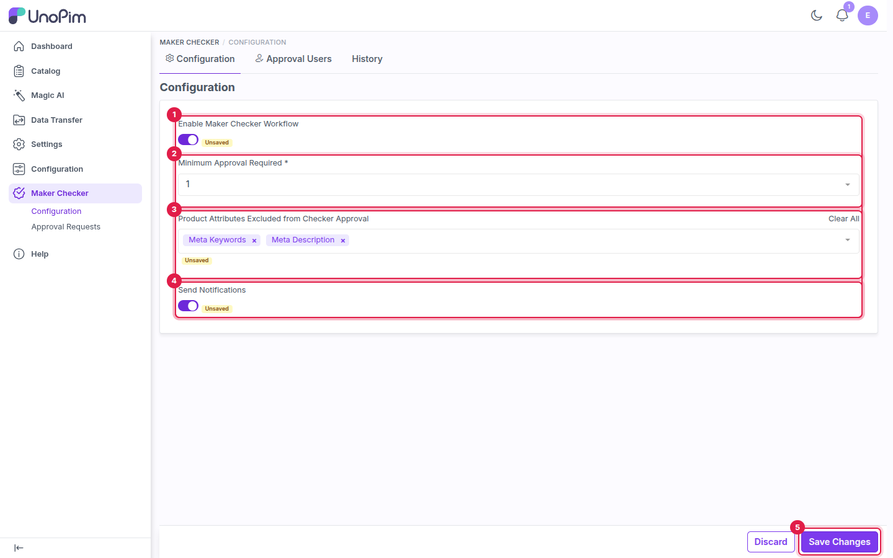
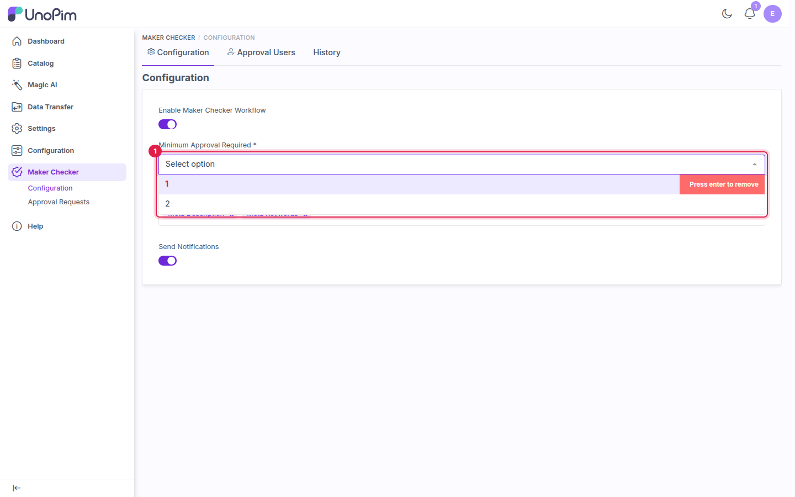
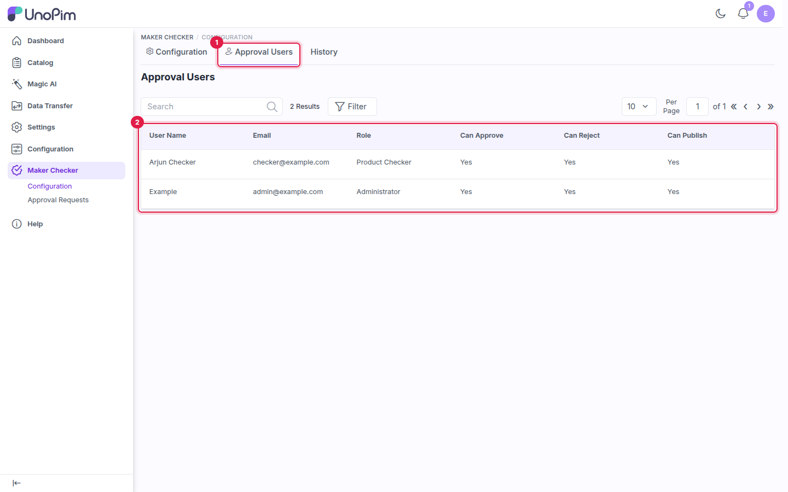
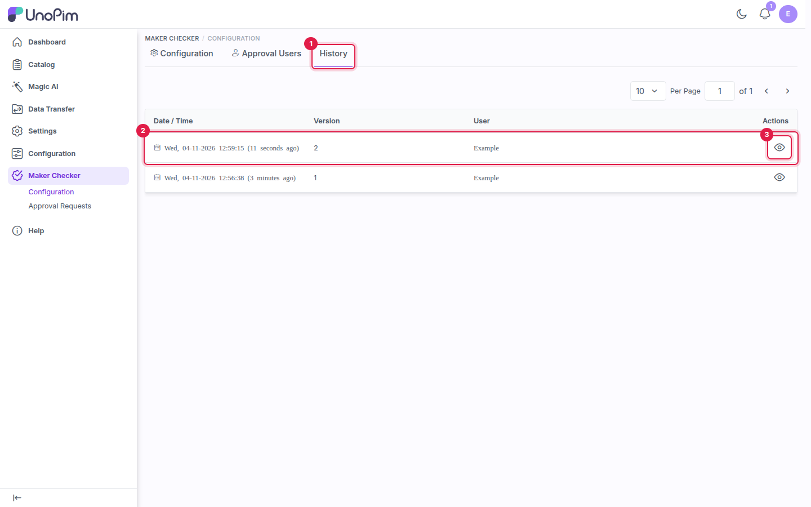
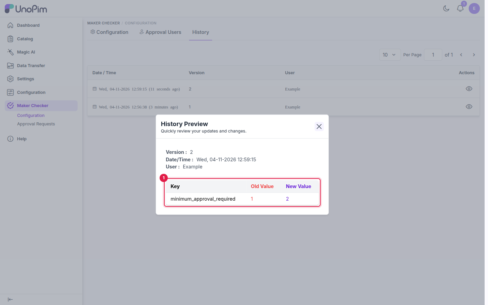

# Configuration

Go to **Maker Checker → Configuration** to turn the workflow on and decide how approvals work. The page has three tabs: **Configuration**, **Approval Users** and **History**.

---

## Enable the workflow

The workflow is off after installation, and only the **Enable Maker Checker Workflow** toggle is shown.

1. **Enable Maker Checker Workflow**: turn it on to show the remaining settings.

While the workflow is disabled, product and asset changes save directly, as in a standard UnoPim install.

## Configure the settings

After enabling the workflow, fill in the settings and click **Save Changes**.

| # | Field | Required | Description |
|---|---|---|---|
| 1 | **Enable Maker Checker Workflow** | - | Turns the approval workflow on or off. |
| 2 | **Minimum Approval Required** | Yes | How many different approval users must approve a draft before it becomes **Approved** and can be published. |
| 3 | **Product Attributes Excluded from Checker Approval** | No | Attributes that skip the workflow. Changes to these are saved straight to the live product, with no draft. Use **Clear All** to empty the list. |
| 4 | **Send Notifications** | No | Sends in-app and email notifications for requests, approvals, rejections, comments and publishing. |
| 5 | **Save Changes** | - | Saves the configuration. The message *Maker Checker Configuration Saved Successfully* confirms it. |

### Minimum Approval Required

The options in this list run from 1 up to the current number of [approval users](#approval-users). For example, with two approval users you can pick **1** or **2**.

1. The available values. Add more checker accounts to raise the maximum.

Each approval user can approve a given draft only once. With a minimum of **2**, two different users must approve the draft before it can be published.

### Excluded attributes

Excluded attributes are useful for low-risk fields that are updated often, such as **Meta Keywords** or **Meta Description**. On the product edit page they're marked with an **Approval Excluded** badge, so makers know the change goes live at once. See [Maker: Create and Submit Drafts](./maker-guide#excluded-attributes).

---

## Approval Users

The **Approval Users** tab lists every active user who can act on approval requests, with the actions their role allows.

1. The **Approval Users** tab.
2. Each user's **Role** and whether they **Can Approve**, **Can Reject** and **Can Publish**.

The tab is available only while the workflow is enabled. If the workflow is off, UnoPim shows *Maker Checker Disabled* and stays on the configuration tab.

## History

The **History** tab records each time the configuration is saved: the date and time, a version number and the user who saved it.

1. The **History** tab.
2. One row per saved version.
3. The **view** icon opens the details of that version.

Click the view icon to open the **History Preview**, which lists each changed field with its old and new value.

1. Every field changed in this version, with its **Old Value** and **New Value**.

## What's next

[Edit a product as a maker and send it for approval](./maker-guide).
