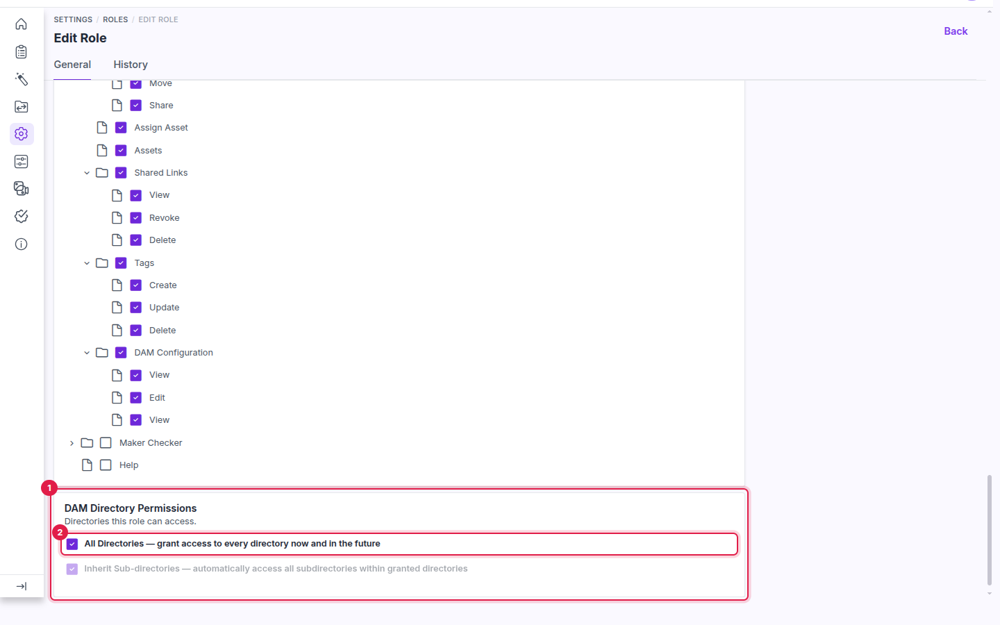
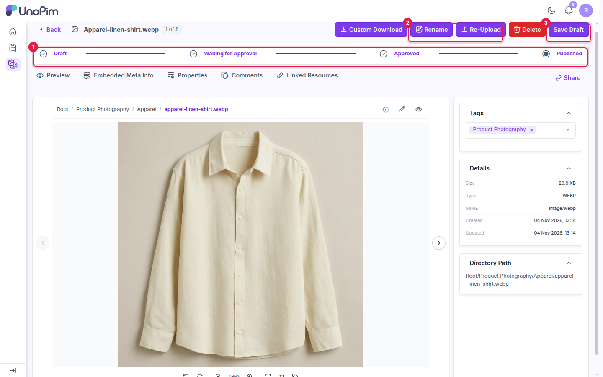
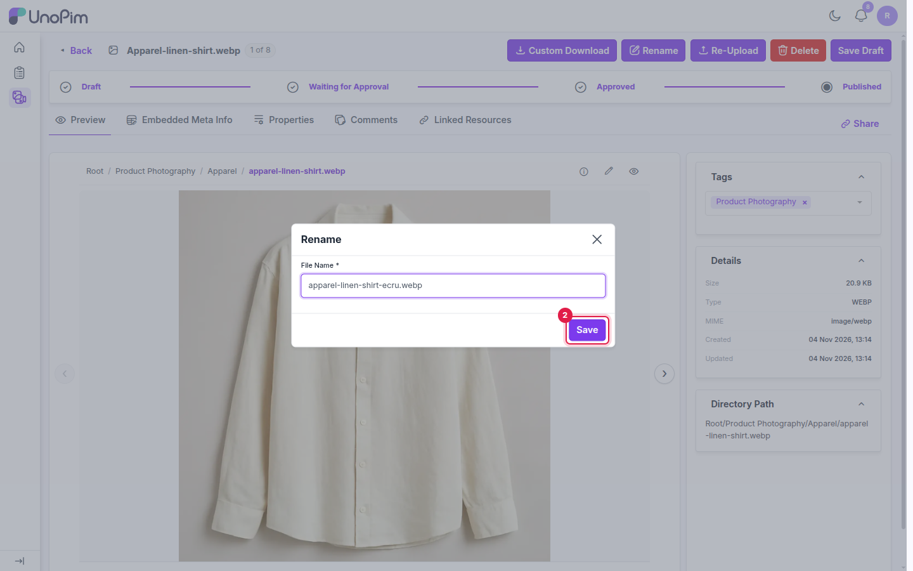
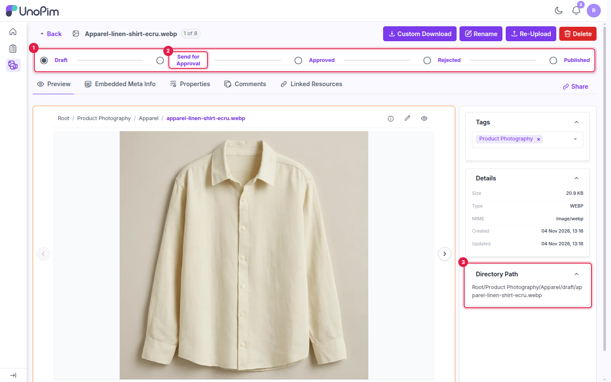
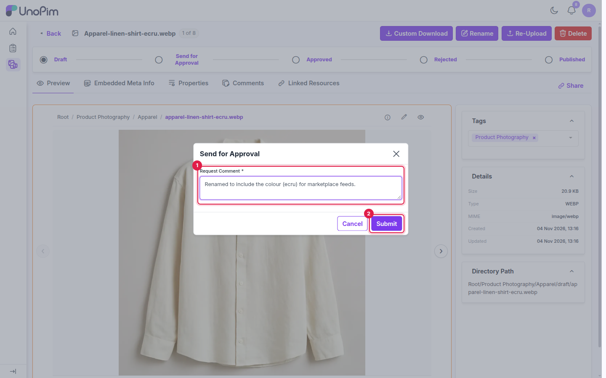
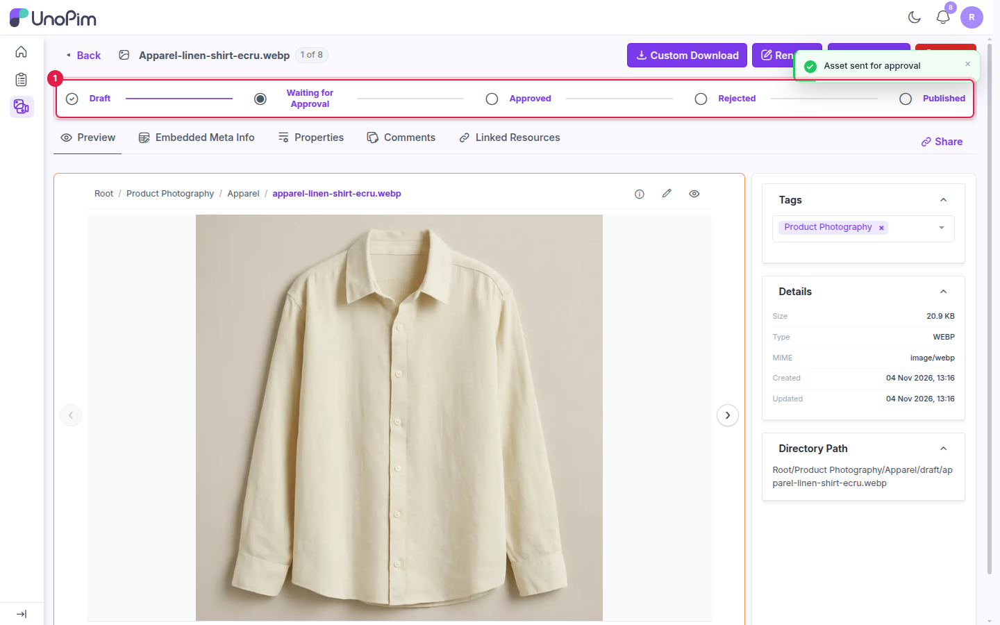
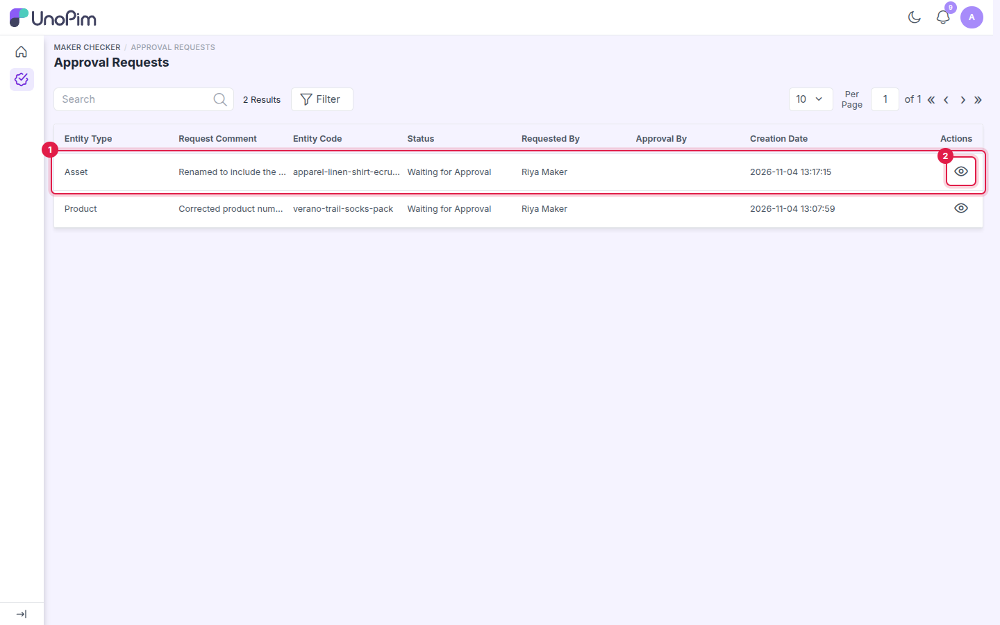
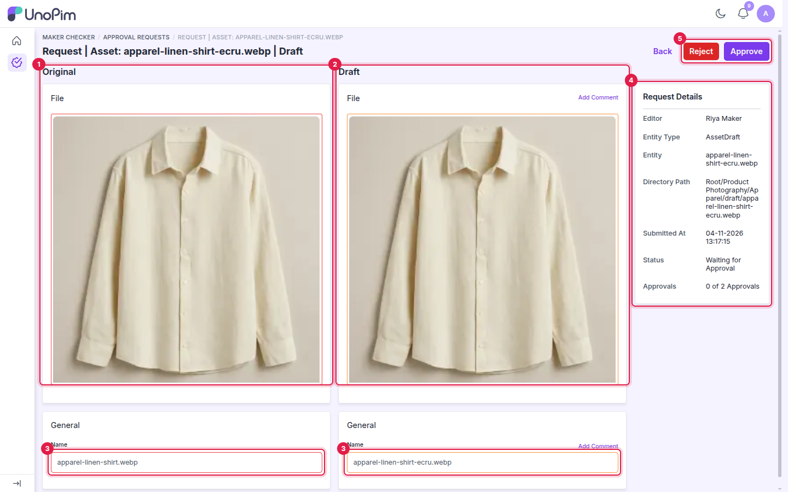
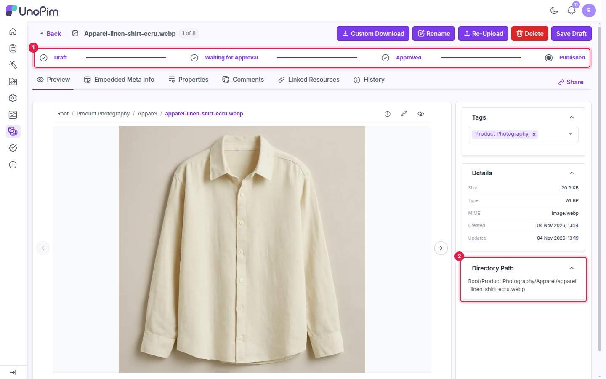

# DAM Asset Approvals

When the **UnoPim DAM** (Digital Asset Management) extension is installed, asset changes go through the same maker-checker workflow as products. A maker's change is saved as an asset draft, a checker reviews it, and it goes live only when it's published.

> [!IMPORTANT]
> Install Maker Checker first, then install UnoPim DAM. See [Installation](./installation).

---

## Before you start

The roles need access to the assets:

- **DAM permissions**: in **Settings → Roles**, select the **DAM** section (or at least the asset view, edit, rename and re-upload permissions) for the maker role.
- **DAM Directory Permissions**: in the same role form, select **All Directories**, or pick the folders the maker works in. Without folder access the asset preview doesn't load.

1. **DAM Directory Permissions**: the folders this role can open.
2. **All Directories**: gives access to every folder, now and in the future.

Checkers don't need the **DAM** asset permissions to review asset requests, but their role also needs **DAM Directory Permissions** for the folders they review, so the file previews load.

## Step 1 - Edit the asset (maker)

Go to **DAM**, open an asset and make a change. With the workflow enabled, the asset page shows the same status tracker as products, and a **Save Draft** button.

1. The status tracker. **Published** means no draft is open.
2. **Rename** and **Re-Upload**: change the file name or replace the file.
3. **Save Draft**: saves pending changes as a draft.

For example, click **Rename**, enter the new **File Name** and click **Save**.

1. **File Name**: the new name.
2. **Save**: saves the change as a draft.

The change is stored as a draft, and the live asset keeps its original name and file. The tracker moves to **Draft**, and the draft copy is kept in a `draft` sub-folder of the asset's folder.

1. The tracker is now at **Draft**.
2. **Send for Approval**: the next step.
3. **Directory Path**: the draft copy's location in the `draft` sub-folder.

## Step 2 - Send the draft for approval (maker)

1. In the tracker, click **Send for Approval**.
2. Enter a **Request Comment**. It's required.
3. Click **Submit**.

1. **Request Comment**: what changed and why.
2. **Submit**: sends the request.

UnoPim shows *Asset sent for approval*, and the tracker moves to **Waiting for Approval**.

1. The tracker is at **Waiting for Approval**.

## Step 3 - Review the asset (checker)

Asset requests appear in **Maker Checker → Approval Requests** together with product requests, with **Asset** in the **Entity Type** column.

1. The asset request.
2. The **view** icon opens the request.

The request page compares the original asset with the draft: the file preview and each changed field, such as **Name**.

| # | Area | Description |
|---|---|---|
| 1 | **Original** | The live file. |
| 2 | **Draft** | The draft file. Use **Add Comment** to comment on it. |
| 3 | **Name** | The original and draft file name. |
| 4 | **Request Details** | Editor, entity, the draft's directory path, submission time, status and approvals. |
| 5 | **Reject / Approve** | Actions available to your role. |

## Step 4 - Approve and publish (checker)

Approve, reject and publish work exactly as for products. See [Checker: Review and Approve](./checker-guide#step-3-approve-the-draft) and [Rejecting and Resubmitting](./reject-and-resubmit).

- After each approval UnoPim shows *Asset draft approved successfully*.
- Once the **Minimum Approval Required** is reached, the status changes to **Approved** and **Publish** appears.
- Publishing applies the draft to the live asset and removes the request from the list.

After publishing, the live asset carries the new name or file, and the `draft` copy is gone.

1. The tracker is back at **Published**.
2. **Directory Path**: the asset is back in its original folder with the new name.

## Limitations

- While the workflow is enabled, assets can't be deleted with the grid's mass-delete action. UnoPim shows *If maker checker is enabled, you can't destroy assets by mass action.*
- **Product Attributes Excluded from Checker Approval** applies only to products. All asset changes need approval.
