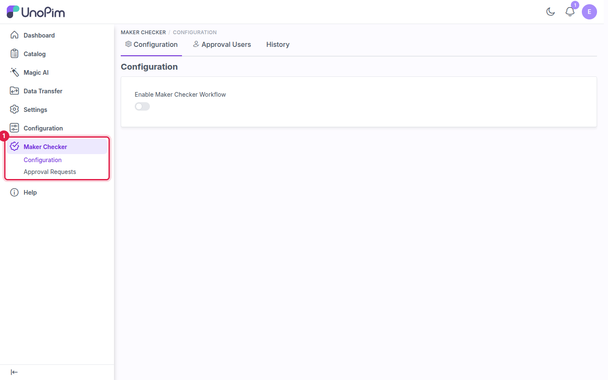

# Installation

Follow these steps to install the UnoPim Maker Checker Workflow extension.

> [!IMPORTANT]
> If you also use the **UnoPim DAM** extension, install Maker Checker first, then install DAM.

---

## Step 1 - Add the package files

Download the extension ZIP file and unzip it. Merge the `packages/` folder from the ZIP into the root of your UnoPim project, so the module ends up in:

```
packages/Webkul/MakerChecker
```

## Step 2 - Register the service provider

Open `bootstrap/providers.php` and add the following line to the list of providers:

```php
Webkul\MakerChecker\Providers\MakerCheckerServiceProvider::class,
```

## Step 3 - Register the Concord module

Open `config/concord.php` and add the module's provider to the `modules` array, after the other `Webkul\...\ModuleServiceProvider` entries:

```php
'modules' => [
    // ...existing modules...
    Webkul\MakerChecker\Providers\ModuleServiceProvider::class,
],
```

> [!WARNING]
> If you skip this step, **Maker Checker → Configuration** fails with the error `Target [Webkul\MakerChecker\Contracts\Configuration] is not instantiable`.

## Step 4 - Update Composer autoload

Open `composer.json` and add the following line under the `autoload > psr-4` section:

```json
"Webkul\\MakerChecker\\": "packages/Webkul/MakerChecker/src"
```

## Step 5 - Run the setup commands

Run the following commands in order:

```bash
composer dump-autoload
php artisan optimize:clear
php artisan migrate
php artisan vendor:publish --provider="Webkul\MakerChecker\Providers\MakerCheckerServiceProvider"
php artisan db:seed --class="Webkul\MakerChecker\Database\Seeders\MakerCheckerStagesSeeder"
```

| Command | Purpose |
|---|---|
| `composer dump-autoload` | Regenerates Composer's autoloader so UnoPim can find the module's classes. |
| `php artisan optimize:clear` | Clears cached bootstrap, configuration, route and view files. |
| `php artisan migrate` | Creates the Maker Checker tables (configuration, drafts, comments and stages). |
| `php artisan vendor:publish ...` | Copies the module's compiled CSS, JS and images to `public/themes`. |
| `php artisan db:seed ...` | Seeds the workflow stages: Draft, Waiting for Approval, Approved, Rejected and Published. |

> [!NOTE]
> The package ships with pre-built front-end assets, which `vendor:publish` copies into place. Run `npm install && npm run build` only if you change the package's front-end source.

## Step 6 - Configure email

Notifications are also sent by email. Add your mail settings to `.env`:

```bash
MAIL_MAILER=smtp
MAIL_HOST=smtp.example.com
MAIL_PORT=587
MAIL_USERNAME=your_username
MAIL_PASSWORD=your_password
MAIL_ENCRYPTION=tls
MAIL_FROM_ADDRESS=pim@example.com
```

Then run `php artisan optimize:clear` again so the new settings load.

## Step 7 - Start the queue worker

Email notifications are queued, so a queue worker must be running:

```bash
php artisan queue:work
```

> **Tip:** On a live server, run the queue worker under a process manager such as Supervisor, so it restarts automatically after a crash or deploy.

---

## Verify the installation

Log in to UnoPim as an administrator. A **Maker Checker** entry with **Configuration** and **Approval Requests** links appears in the left sidebar. That confirms the extension is installed.



If the menu doesn't appear, run `php artisan optimize:clear` again and refresh the page.

## What's next

1. [Create the maker and checker roles and users](./roles-and-users).
2. [Enable and configure the workflow](./configuration).
