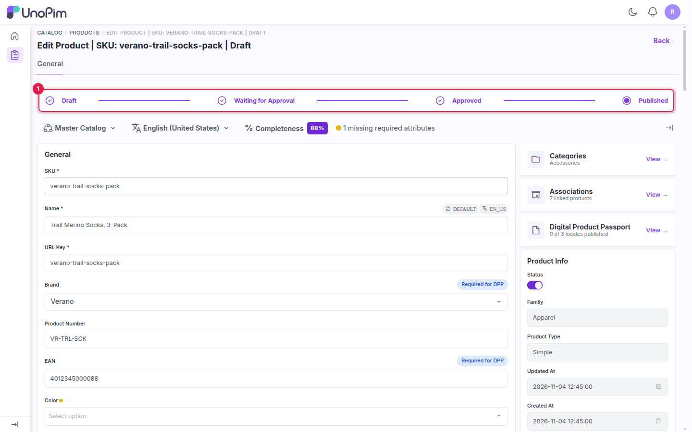
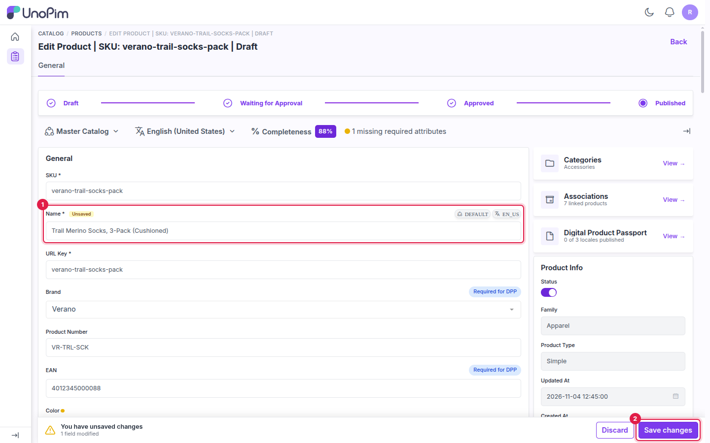
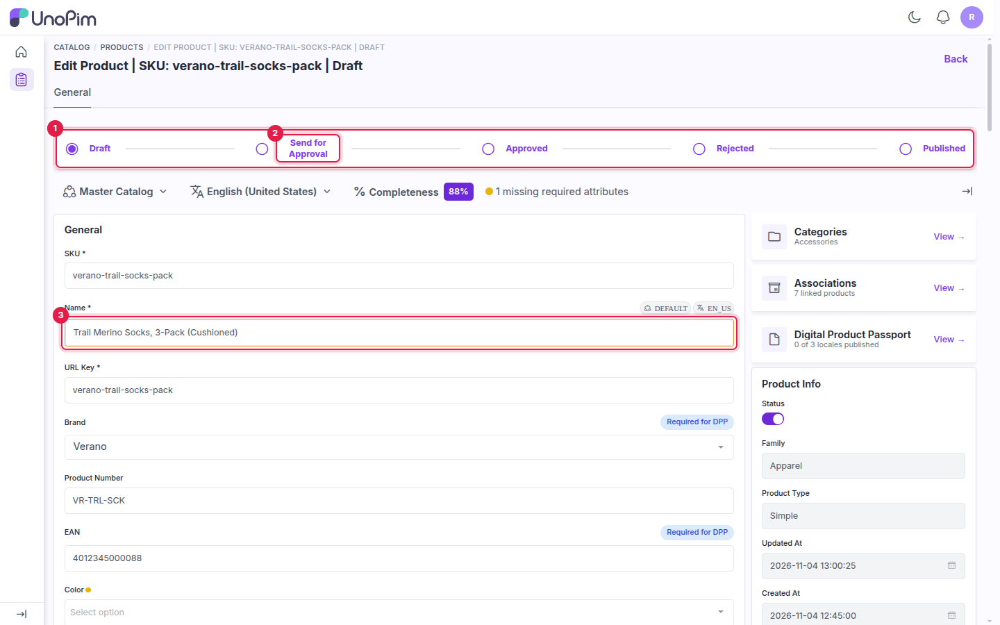
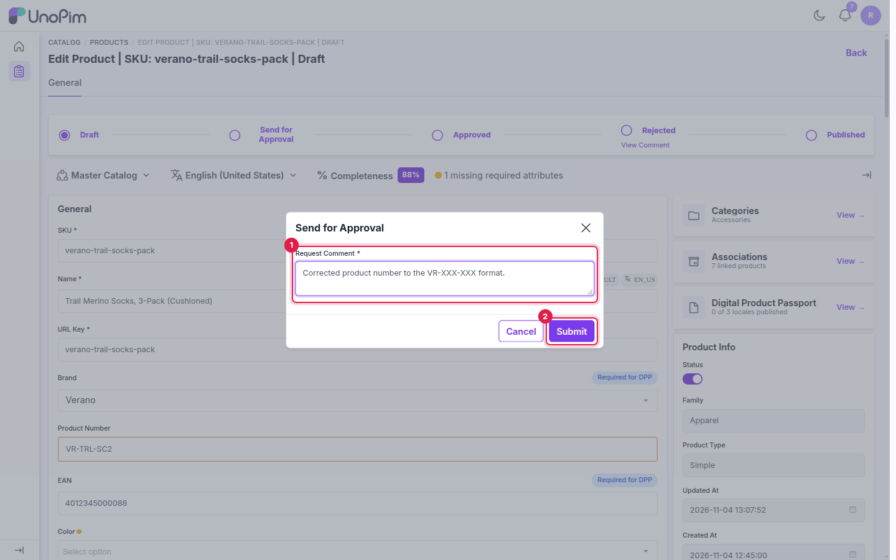
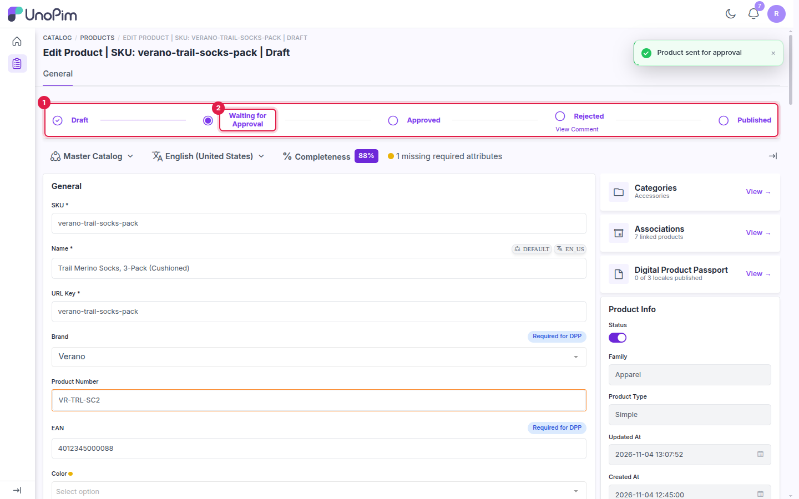
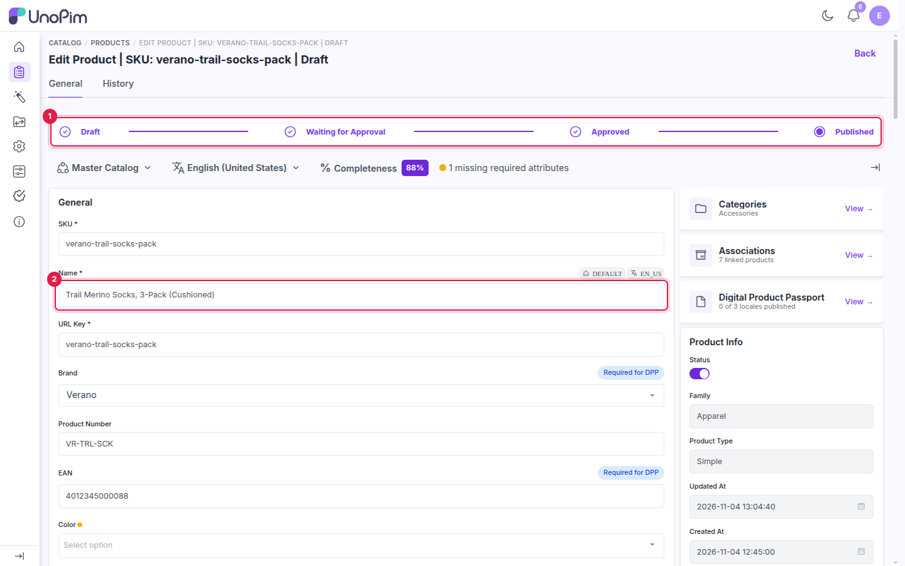
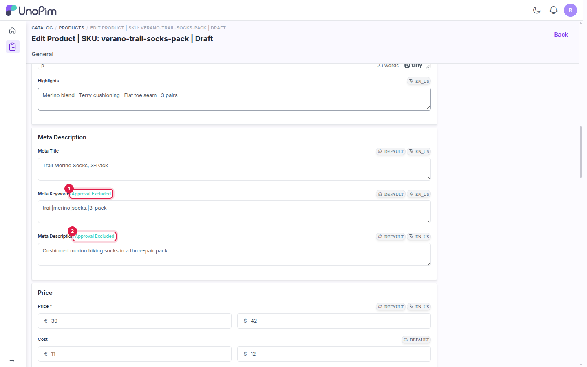

# Maker: Create and Submit Drafts

This page covers the maker's side of the workflow: editing a product, saving it as a draft and sending it for approval.

---

## The status tracker

With the workflow enabled, every product edit page shows a status tracker above the attributes. A product with no open draft shows **Published**, meaning the live data is what you see.

1. The tracker stages: **Draft**, **Waiting for Approval**, **Approved** (or **Rejected**) and **Published**.

## Step 1 - Edit the product

1. Go to **Catalog → Products** and open the product.
2. Change one or more attribute values.
3. Click **Save changes**.

1. The changed attribute.
2. **Save changes**: saves the change as a draft.

The change isn't applied to the live product. It's stored as a **draft**, and the tracker moves to **Draft**.

1. The tracker is now at **Draft**.
2. **Send for Approval**: the next step.
3. Changed fields are outlined, so you can see what's in the draft.

You can keep editing and saving the draft until you're ready. If you save without changing anything, UnoPim shows *No changes detected to save.*

## Step 2 - Send the draft for approval

1. In the tracker, click **Send for Approval**.
2. Enter a **Request Comment** that explains the change for the checker. The comment is required.
3. Click **Submit**.

1. **Request Comment**: a short note for the checker.
2. **Submit**: sends the request.

UnoPim shows *Product sent for approval*, and the tracker moves to **Waiting for Approval**. The request now appears in the checkers' [Approval Requests](./checker-guide) list, and approval users are notified.

1. The status tracker.
2. **Waiting for Approval**: the draft is with the checkers.

> [!NOTE]
> The live product, the product grid and any exports keep showing the original values until the draft is published.

> [!NOTE]
> For a variant product, the parent product must be published first. Otherwise UnoPim shows *Publish the parent product first*.

## Step 3 - Track the result

You're notified when the checker acts on your request (see [Notifications](./notifications)):

- **Approved**: once the required number of approvals is reached, the tracker moves to **Approved**. A checker can then publish it.
- **Rejected**: the tracker moves to **Rejected**. See [Rejecting and Resubmitting](./reject-and-resubmit).
- **Published**: the draft values are now live, and the tracker shows **Published** again.

1. The tracker is back at **Published**.
2. The product now carries the approved value.

---

## Excluded attributes

Attributes listed in **Product Attributes Excluded from Checker Approval** (see [Configuration](./configuration#excluded-attributes)) show an **Approval Excluded** badge next to their label.

1. **Meta Keywords**: excluded from approval.
2. **Meta Description**: excluded from approval.

Changes to these attributes are saved straight to the live product and don't create a draft. If you save excluded and non-excluded changes together, only the non-excluded ones go into the draft.

## What's next

[See how checkers review and approve your request](./checker-guide).
