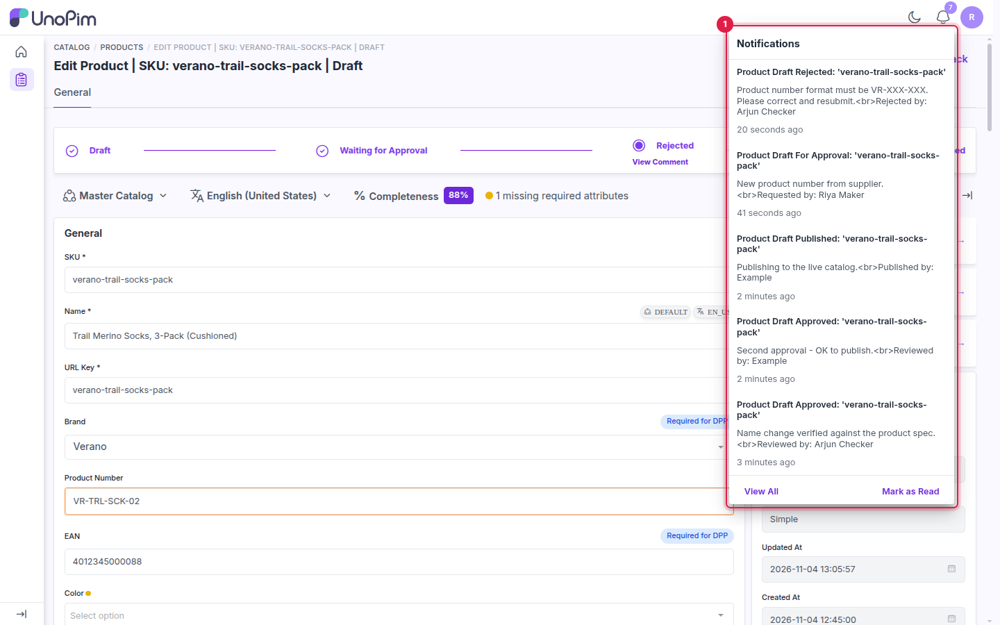

# Notifications

When **Send Notifications** is turned on in [Configuration](./configuration), every workflow action sends an in-app notification and an email.

---

## In-app notifications

Click the bell icon at the top right of UnoPim to see recent notifications. Each one names the product, includes the comment entered with the action, and shows who acted.

1. The notification panel. Use **View All** to see the full list and **Mark as Read** to clear the counter.

## Notification types

| Notification | Sent when |
|---|---|
| **Product Draft For Approval** | A maker sends a draft for approval. |
| **Product Draft Approved** | A checker approves the draft. One is sent for each approval. |
| **Product Draft Rejected** | A checker rejects the draft. |
| **Product Draft Published** | A checker publishes the draft. |
| **Product Draft Commented** | A checker adds a field comment. |

DAM assets send the same set of notifications for asset drafts.

Notifications go to the approval users (see [Approval Users](./configuration#approval-users)) and to the maker involved in the request.

## Email notifications

The same events are also sent by email. Emails are queued, so they need:

- valid mail settings in `.env` (see [Installation](./installation#step-6-configure-email)), and
- a running queue worker (`php artisan queue:work`).

If in-app notifications arrive but emails don't, check that the queue worker is running and look at `storage/logs/laravel.log` for mail errors.

## What's next

[Use the workflow for DAM assets](./dam-assets).
