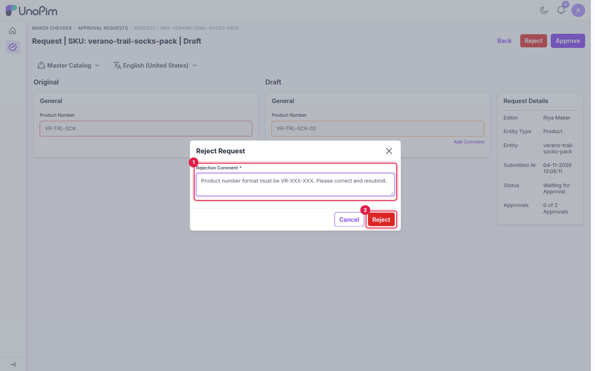
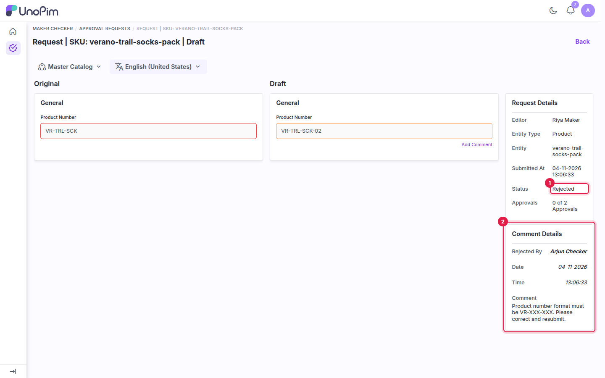
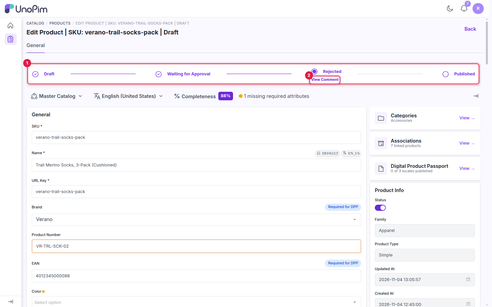
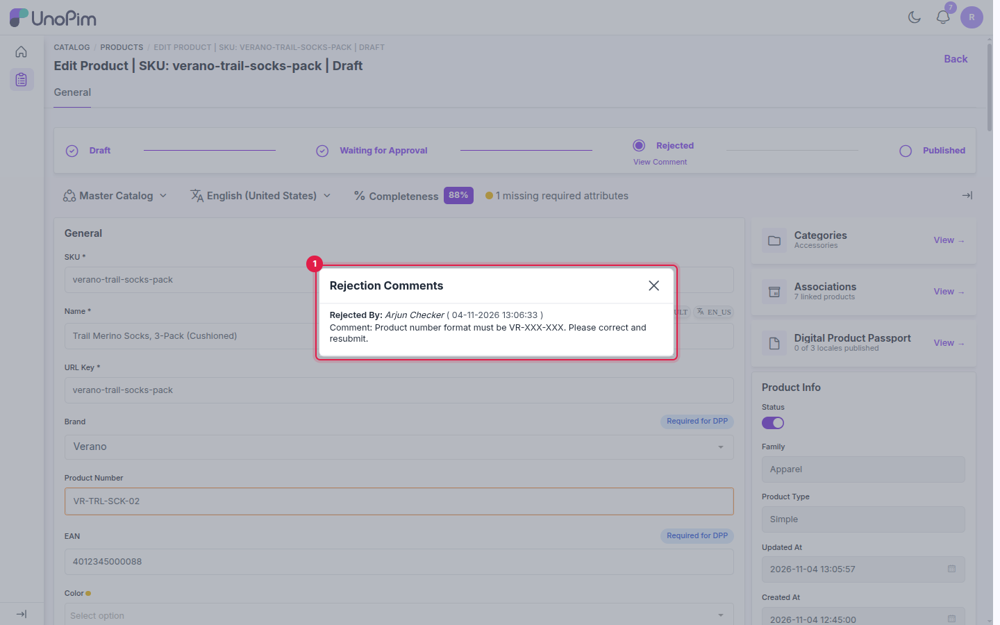

# Rejecting and Resubmitting

If a draft isn't right, the checker rejects it with a reason. The maker sees the reason, corrects the draft and sends it again.

---

## Reject a draft (checker)

1. Open the request from **Maker Checker → Approval Requests**.
2. Click **Reject**.
3. Enter a **Rejection Comment** that tells the maker what to fix. It's required.
4. Click **Reject** in the dialog.

1. **Rejection Comment**: what the maker needs to change.
2. **Reject**: rejects the draft.

UnoPim shows *Draft product rejected*. The status changes to **Rejected**, and your comment is added to **Comment Details**.

1. **Status**: **Rejected**.
2. **Comment Details**: who rejected it, when, and why.

A draft can be rejected while it's waiting for approval or after it's approved, as long as it hasn't been published. The live product isn't changed.

## See why a draft was rejected (maker)

The maker gets a *Product Draft Rejected* notification. On the product edit page, the tracker shows **Rejected** with a **View Comment** link.

1. The tracker is at **Rejected**.
2. **View Comment**: shows the checker's reason.

Click **View Comment** to read who rejected the draft, when, and their comment.

1. The checker's name, the date and time, and the rejection comment.

## Resubmit the draft (maker)

1. Correct the values on the product edit page and click **Save changes**. The tracker moves back to **Draft**.
2. Click **Send for Approval**, enter a **Request Comment** describing the fix, and click **Submit**.

The request returns to **Waiting for Approval** in the checkers' list. The approval count starts again from zero, and the earlier rejection comment stays in **Comment Details** for reference.

## What's next

[See which notifications each action sends](./notifications).
