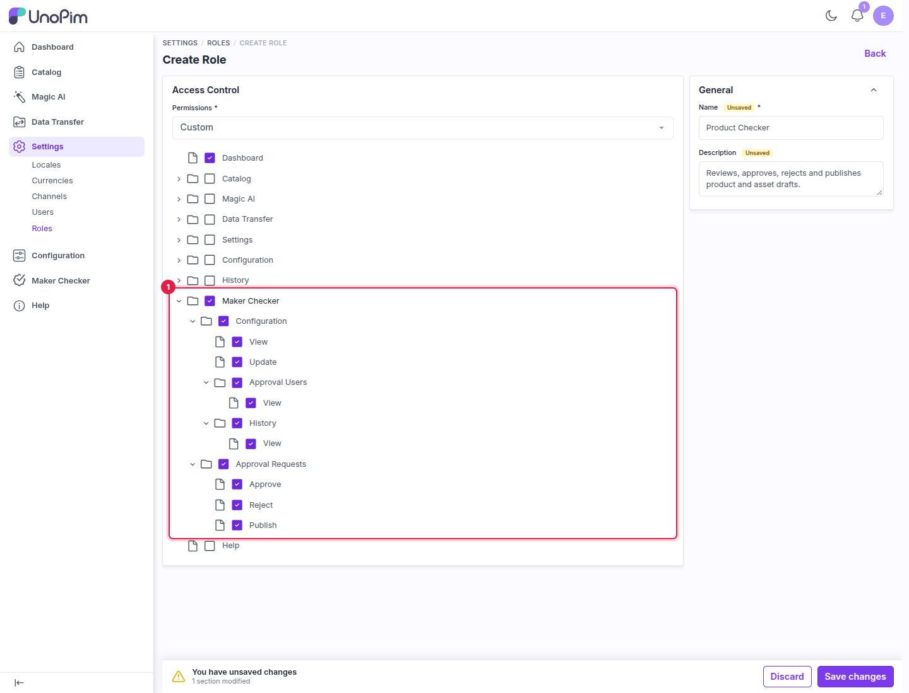
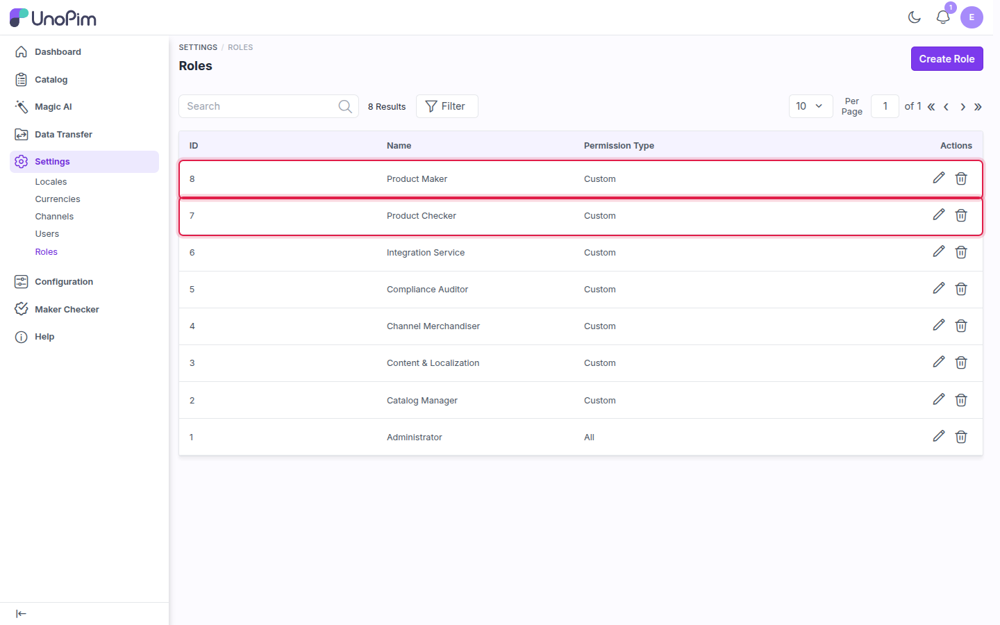
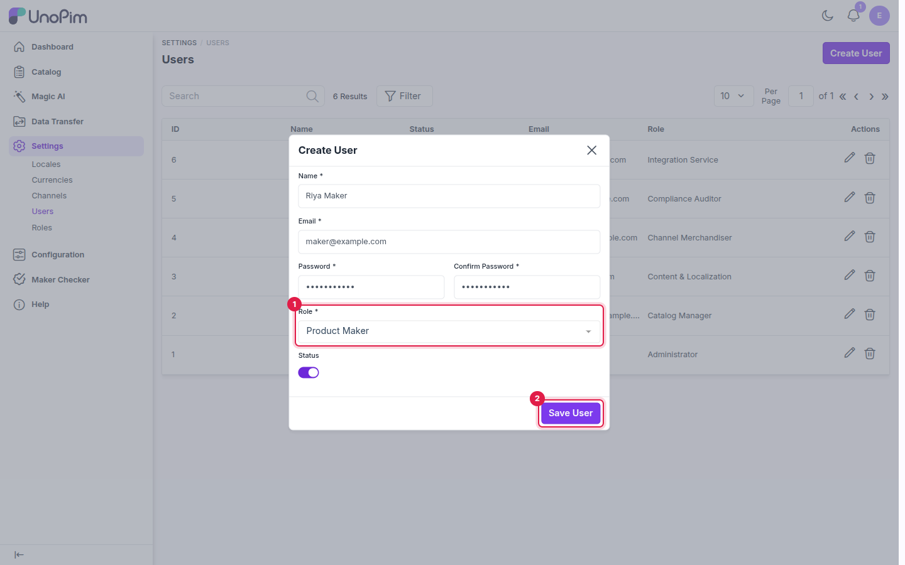

# Roles and Users

Maker Checker uses UnoPim's standard roles and permissions. Create one role for makers and one for checkers, then assign users to them.

---

## Maker Checker permissions

When you create or edit a role under **Settings → Roles**, the permission tree has a **Maker Checker** section:

| Permission | Allows the user to |
|---|---|
| **Configuration → View** | Open the Maker Checker configuration page. |
| **Configuration → Update** | Change and save the configuration. |
| **Configuration → Approval Users → View** | See the **Approval Users** tab. |
| **Configuration → History → View** | See the **History** tab of the configuration. |
| **Approval Requests → Approve** | Approve drafts. |
| **Approval Requests → Reject** | Reject drafts. |
| **Approval Requests → Publish** | Publish approved drafts to the live catalog. |

A user counts as an **approval user** (a checker) if their account is active and their role has at least one of **Approve**, **Reject** or **Publish**, or the role's permission type is **All**. Administrators are therefore always approval users.

---

## Step 1 - Create the checker role

1. Go to **Settings → Roles** and click **Create Role**.
2. Enter a name, for example `Product Checker`, and a description.
3. Set **Permissions** to **Custom**.
4. In the permission tree, select **Dashboard** and the whole **Maker Checker** section.
5. Click **Save Role**.

1. The **Maker Checker** section with **Configuration**, **Approval Users**, **History** and **Approval Requests** (Approve, Reject, Publish).

## Step 2 - Create the maker role

1. Click **Create Role** again.
2. Enter a name, for example `Product Maker`.
3. Set **Permissions** to **Custom** and select **Dashboard** and **Catalog** (products, and any other catalog areas the maker works on).
4. If makers also edit DAM assets, select the **DAM** section and set **DAM Directory Permissions**. See [DAM Asset Approvals](./dam-assets#before-you-start).
5. Don't select any **Maker Checker → Approval Requests** permission. A maker can't approve their own work.
6. Click **Save Role**.

Both roles now appear in the roles list.

1. The new **Product Maker** role.
2. The new **Product Checker** role.

## Step 3 - Create the users

1. Go to **Settings → Users** and click **Create User**.
2. Fill in **Name**, **Email**, **Password** and **Confirm Password**.
3. In **Role**, select **Product Maker** for a maker or **Product Checker** for a checker.
4. Turn on **Status**.
5. Click **Save User**.

1. **Role**: the role decides whether the user is a maker or a checker.
2. **Save User**: creates the account.

Repeat for each maker and checker. If you need more than one approval per draft, create at least as many checker accounts as the number of approvals you want to require.

## What's next

[Enable the workflow and set the minimum number of approvals](./configuration).
