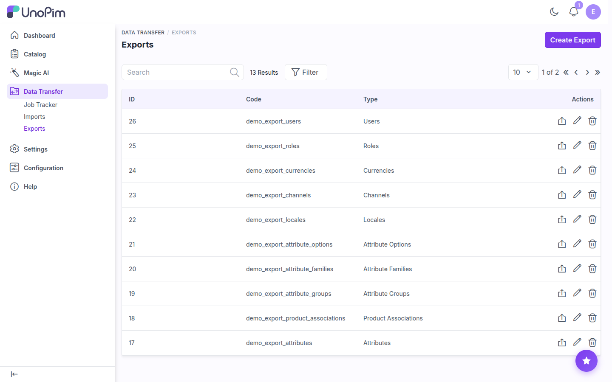
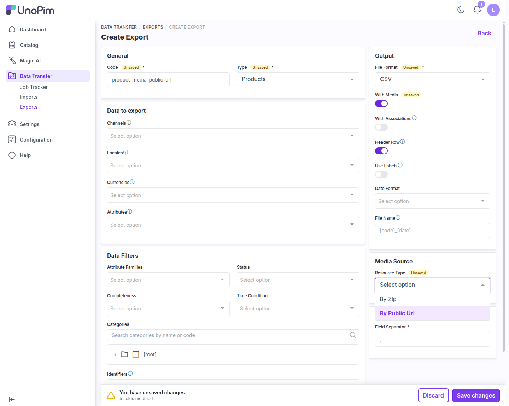
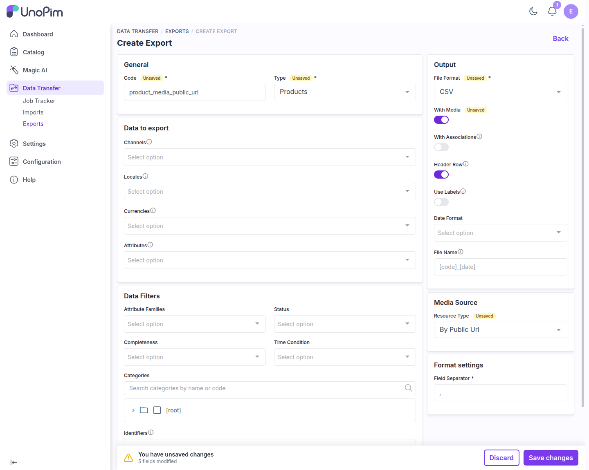
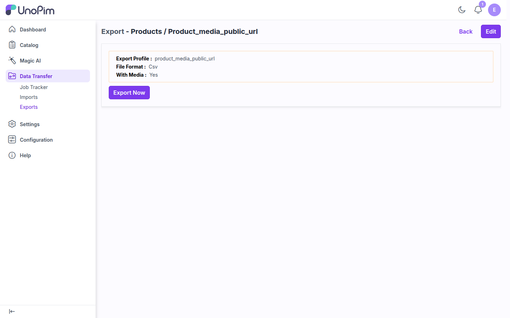
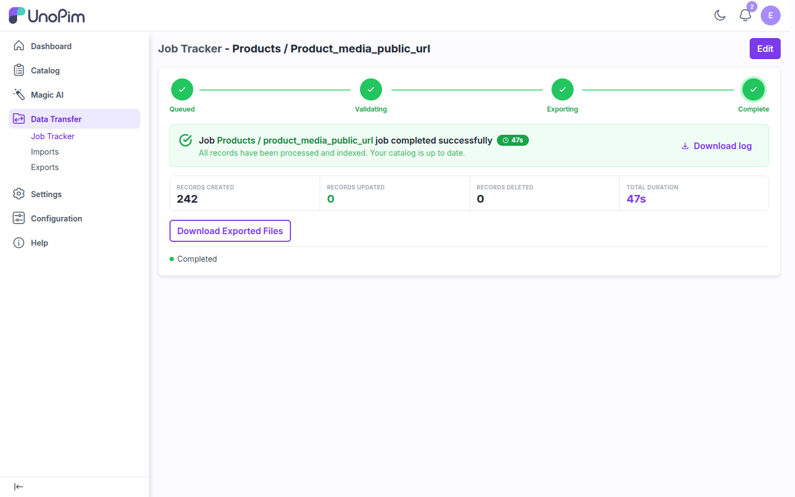
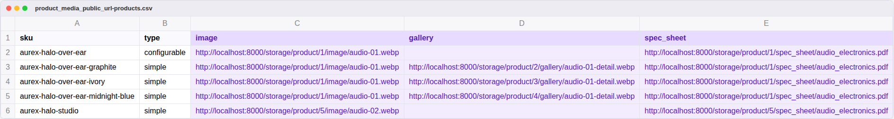

# Export Product Media as Public URLs

With the **UnoPim Public Image URL** extension, a product export can write each media value (**image**, **gallery**, and **file** attributes) as a public link instead of packing the files into a ZIP archive.

The extension adds a **Resource Type** option to product export profiles:

| Resource Type | What you get |
|---|---|
| **By Public Url** | One CSV/XLS/XLSX file. Each media column contains a full public URL, such as `https://your-domain.com/storage/product/1/image/audio-01.webp`. |
| **By Zip** | A ZIP archive with the export file plus the media files. This is UnoPim's standard behaviour. |

> **Note:** Resource Type only appears for **Products** exports, and only takes effect when **With Media** is turned on. With media turned off, the export writes the stored media paths and Resource Type is ignored.

## Step 1: Open the Exports page

Go to **Data Transfer > Exports** and click **Create Export**.

## Step 2: Fill in the export profile

1. In **General**, enter a **Code** (for example `product_media_public_url`) and set **Type** to **Products**.
2. Optional: use **Data to export** and **Data Filters** to limit channels, locales, attributes, families, categories, or SKUs. Leave them empty to export everything.
3. In **Output**:
   - Set **File Format** to **CSV**, **XLS**, or **XLSX**.
   - Turn on **With Media**. The **Media Source** section appears below it.
4. In **Media Source**, set **Resource Type** to **By Public Url**.

When everything is filled in, the form looks like this:

5. Click **Save changes**.

### Media-related settings

| Setting | Where | Description |
|---|---|---|
| **File Format** | Output | `CSV`, `XLS`, or `XLSX`. |
| **With Media** | Output | Must be on for media to be exported as URLs or ZIP files. |
| **Resource Type** | Media Source | **By Public Url** writes links. **By Zip** bundles the files. |
| **Field Separator** | Format settings | Delimiter for CSV files, for example `,` or `;`. |

## Step 3: Run the export

After saving, the profile summary opens. Click **Export Now**.

The **Job Tracker** shows the job moving through **Queued > Validating > Exporting > Complete**.

> **Tip:** Exports run on the queue. If a job stays on **Queued**, make sure a queue worker is running, for example `php artisan queue:work --queue=system,default`.

## Step 4: Download the file

When the job finishes, click **Download Exported Files**.

With **By Public Url**, you get a single CSV/XLSX file (no ZIP). The `image`, `gallery`, and file attribute columns (here `spec_sheet`) contain public URLs:

- **image** and **file** attributes: one URL per cell.
- **gallery** attributes: several URLs in one cell, separated by commas.
- URLs are built from your `APP_URL`, so set `APP_URL` in `.env` to the public domain other systems will use.

## Public URL vs ZIP

| | By Public Url | By Zip |
|---|---|---|
| Download | Single CSV/XLS/XLSX file | ZIP archive (export file + media) |
| Media column value | Full public URL | Relative file path inside the ZIP |
| Best for | Feeds, marketplaces, and integrations that fetch images by URL | Moving media offline or to a system without access to your server |
| Download size | Small | Grows with the number of media files |
