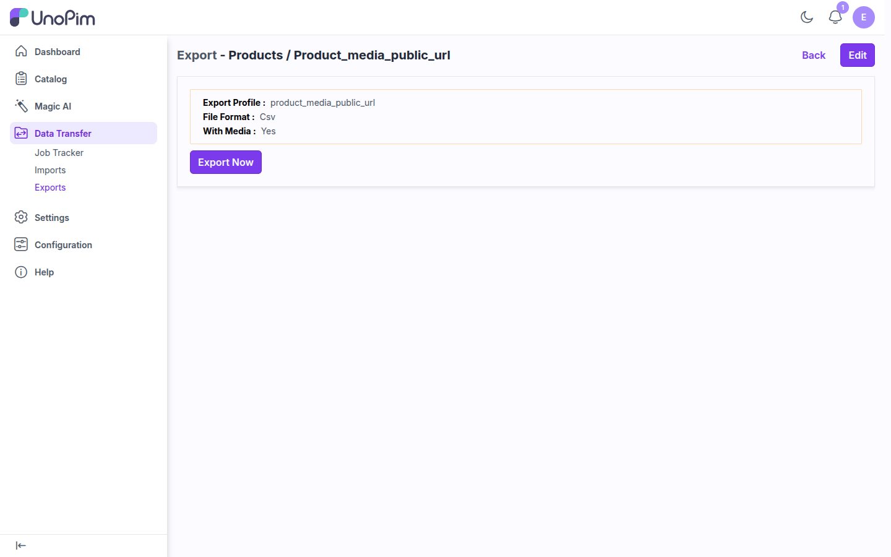
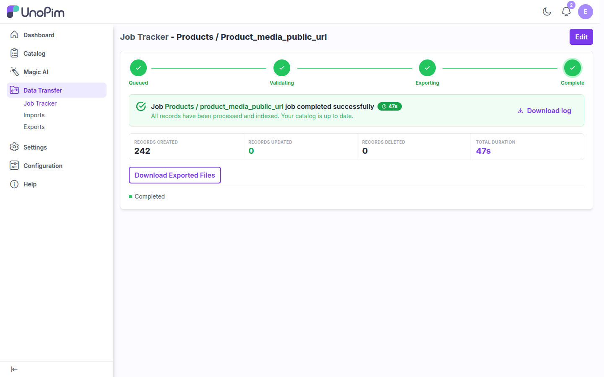

# Use Public Image URL in Exports

After the **UnoPim Public Image URL** extension is installed, you can export product media using **Public URL** or **ZIP** as the resource type.

This is useful when you want product media such as **image**, **gallery**, and **file** attributes to appear in the export file as publicly accessible URLs instead of bundled files.

## What This Export Supports

UnoPim allows you to export product media for product types such as:

- **Simple products**
- **Configurable products**

This export works for **Products** and not for **Categories**.

## Create an Export for Media as Public URL

Follow these steps to create the export:

1. Go to **Data Transfer > Exports > Create Export**.

2. In the **General** section, enter the required fields such as **Code** and **Type**, then select **Products** as the product type.

3. Choose the required file format, such as **CSV** or **XLSX**.

4. Configure the export profile settings as needed.

## Media-Related Export Settings

While editing the export job profile, you can configure the media export options:

| Setting | Description |
|---|---|
| **Field Separator** | Choose the delimiter for the export file, such as `,` or `;`. |
| **File Format** | Select the export format, such as **CSV**, **XLS**, or **XLSX**. |
| **With Media** | Enable this option to include product media in the export. |
| **Resource Type** | Shown in the **Media Source** card only when **With Media** is enabled. Choose **By Public Url** or **By Zip**. Defaults to **By Zip**. |

## Public URL vs ZIP

### Public URL

If **With Media** is enabled and **By Public Url** is selected as the resource type:

- product media values are exported as public URLs,
- the exported URLs remain accessible through the public path,
- image, gallery, and file attributes appear in the export file as links.

### ZIP

If **By Zip** is selected as the resource type:

- media files are copied into the export and downloaded together with the data file as a ZIP archive,
- media columns contain file paths relative to that archive, not URLs,
- this option is useful when you want media packaged differently for download or transfer.

## How Public URLs Are Built

Public URLs are not stored. They are built from the file's storage path each time an export runs or the API is called, using the default filesystem disk (`FILESYSTEM_DISK`):

| Disk | URL in the export |
|---|---|
| `public` (default) | `APP_URL` + `/storage/<path>`. `APP_URL` must be the public domain of your UnoPim, and `php artisan storage:link` must have been run. |
| Disk with `visibility` set to `private` | A temporary signed URL that expires after **60 minutes**. |
| `s3` or another cloud disk | The disk's own URL (its `url` setting, for example a CDN or bucket URL). |
| DAM `asset` attribute on a non-`s3` disk | The DAM file route `<admin URL>/dam/file/fetch/<path>`. |

> [!WARNING]
> If you change `APP_URL` or the disk URL, files exported earlier keep the old URLs. Run the export again to get new URLs. If configuration is cached, run `php artisan config:clear` (or `config:cache`), then `php artisan queue:restart`, because exports run in queue workers that keep the configuration they started with.

## Result of the Export

With this setup, UnoPim makes it easy to export product media along with the product data.

Key benefits include:

- exporting product **image**, **gallery**, and **file** attributes as public URLs,
- support for file formats such as **CSV** and **XLSX**,
- simpler handling of product media during external sharing or integration.

> **Note:** Product media attribute values such as `image`, `file`, and `gallery` can be exported as **Public URL** values.
