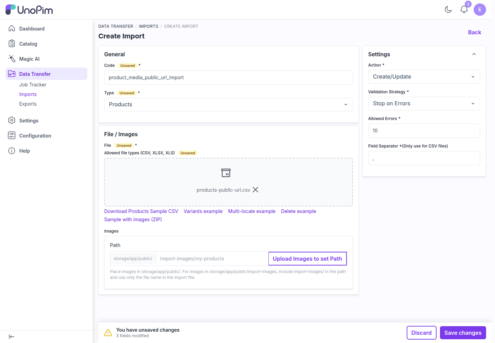

# Use Public Image URL in Imports

After the **UnoPim Public Image URL** extension is installed, you can import product media using public URL values in your import file.

This allows UnoPim to fetch product media automatically and assign it to the correct product attributes during import.

## What This Import Supports

This import works for **Products** only.

You can import media values for product media attributes such as:

- **image**
- **gallery**
- **file**

## Create an Import for Media Using Public URL

Follow these steps to create the import:

1. Go to **Data Transfer > Imports > Create Import**.



2. In the **General** section, enter the required fields such as **Code**, **Type**, and **File**, then select **Products** as the product type.


3. Add the image or media public URL values in your **CSV**, **XLS**, or **XLSX** file.


4. Upload the file in the selected import format.

## Configure Import Settings

Under the **Settings** section, configure the import behavior as needed:

| Setting | Description |
|---|---|
| **Action** | Choose **Create/Update** or **Delete** depending on the import goal. |
| **Recommended Action** | Select **Create/Update** when importing product media URLs. |
| **Validation Strategy** | Choose **Stop on Errors** or **Skip Errors**. |
| **Allowed Errors** | If **Skip Errors** is selected, define how many errors are allowed, such as `10`. |
| **Field Separator** | Choose the delimiter used in the file, such as `,` or `;`. |


## How the Import Works

When the import runs successfully:

- UnoPim reads the product media URL values from the import file,
- fetches the files from the given public URLs,
- assigns them to the correct product media attributes,
- and saves them with the related product data.

The downloaded file is saved to UnoPim's default filesystem disk, and the product stores that local path, not the source URL. Changing or deleting the file at the source URL later does not update the product; import the row again to replace it.

Cells that contain a file name instead of a URL are still read from the import's images directory, as in a normal UnoPim import.

## URL Restrictions

URLs are downloaded by the UnoPim server, so the extension only fetches what is safe:

- Only `http` and `https` URLs on public addresses are fetched. Redirects to internal hosts are not followed.
- Image URLs must answer with an image `Content-Type` (JPEG, PNG, GIF, BMP, WebP, TIFF, SVG, or ICO). Otherwise the row fails with a *"... is not a valid or accessible URL"* error.
- URLs whose file name ends in an HTML, JavaScript, or PHP extension are refused.

To import from a server on your own network, set this in `.env`:

```env
PUBLIC_URL_ALLOW_PRIVATE_NETWORK=true
```

Link-local and cloud-metadata addresses (such as `169.254.169.254`) stay blocked even then.

> [!NOTE]
> Imports run in the queue worker. If configuration is cached, run `php artisan config:cache` after changing `.env`, then `php artisan queue:restart` so running workers load the new value.

## Result After Import

Once the product import is completed successfully, you can open the imported product in UnoPim and verify that the media has been added correctly.

This makes it easier to:

- import product media in bulk,
- avoid manual media uploads,
- and manage product image, gallery, and file attributes more efficiently.

> **Note:** Product media attribute values such as `image`, `gallery`, and `file` can be imported using **Public URL** values.
