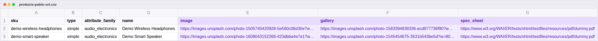
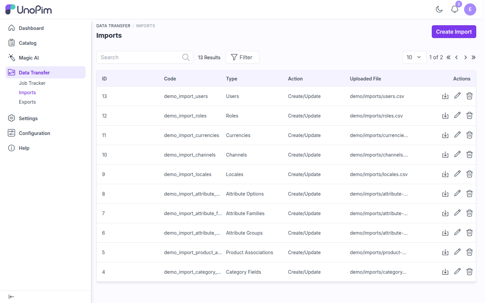
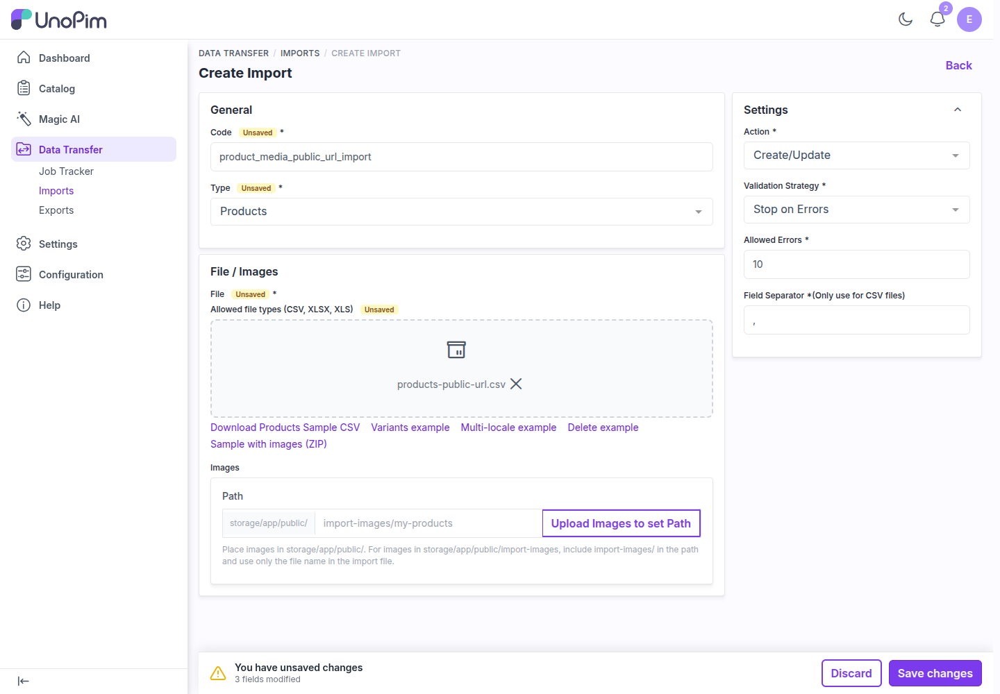
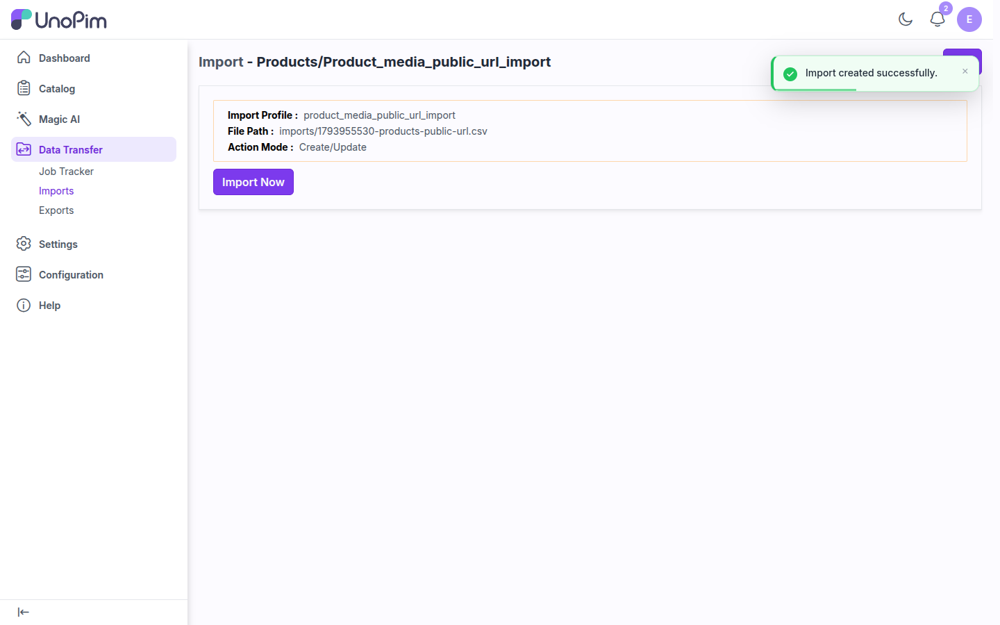
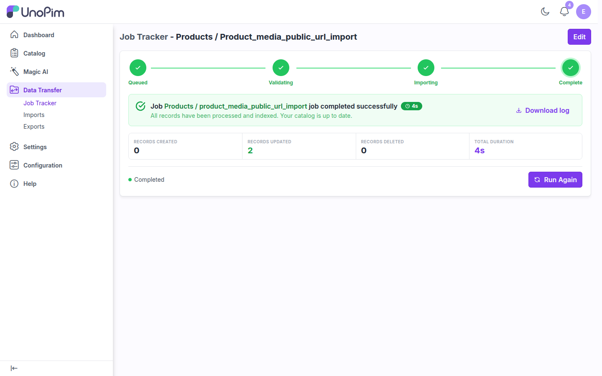
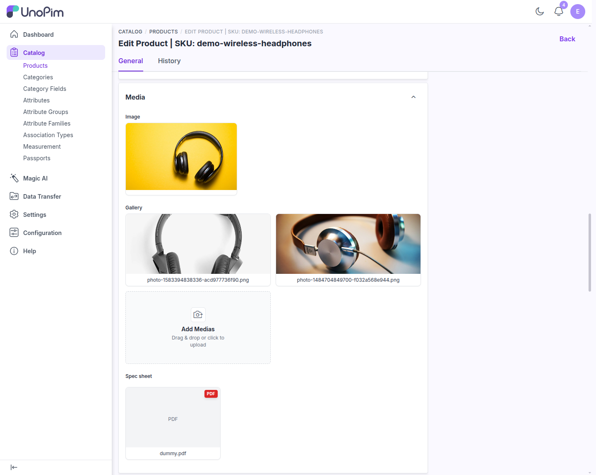

# Import Product Media from Public URLs

With the **UnoPim Public Image URL** extension, you can put public links in the media columns of a product import file. During the import, UnoPim downloads each file, stores it in your own media storage, and assigns it to the product. No manual uploads and no image ZIP are needed.

This works for **product** imports with **image**, **gallery**, and **file** attributes.

## Step 1: Prepare the import file

Start from a normal UnoPim product import file (CSV, XLS, or XLSX) and put public URLs in the media columns:



Example CSV:

```csv
channel,locale,sku,status,type,parent,variant_structure,attribute_family,name,url_key,image,gallery,spec_sheet
default,en_US,demo-wireless-headphones,true,simple,,,audio_electronics,Demo Wireless Headphones,demo-wireless-headphones,https://images.unsplash.com/photo-1505740420928-5e560c06d30e?w=800&fm=jpg,"https://images.unsplash.com/photo-1583394838336-acd977736f90?w=800&fm=jpg,https://images.unsplash.com/photo-1484704849700-f032a568e944?w=800&fm=jpg",https://www.w3.org/WAI/ER/tests/xhtml/testfiles/resources/pdf/dummy.pdf
```

### Rules for media columns

| Attribute type | Value format |
|---|---|
| **Image** | One URL, for example `https://cdn.example.com/products/shoe-01.jpg` |
| **Gallery** | Several URLs separated by commas, wrapped in double quotes in CSV. A JSON array also works. |
| **File** | One URL to the file, for example a PDF spec sheet |

- URLs must start with `http://` or `https://`, be publicly reachable, and return the right content (an image for image/gallery attributes).
- Supported image types: JPEG, PNG, GIF, BMP, WebP, TIFF, SVG, ICO, HEIF, HEIC, and AVIF.
- You can mix URLs and local file names in the same column. Local names are resolved from the import's **Images** path as usual.
- Use URLs that end in different file names, such as `shoe-red-front.jpg` and `shoe-blue-front.jpg`. See [Troubleshooting](#troubleshooting).

> **Tip:** The file must still contain the columns UnoPim v3 requires for products: `channel`, `locale`, `sku`, `type`, `parent`, `variant_structure`, and `attribute_family`, plus any attributes your family marks as required. Click **Download Products Sample CSV** on the Create Import page for a template.

## Step 2: Create the import profile

1. Go to **Data Transfer > Imports** and click **Create Import**.



2. In **General**, enter a **Code** (for example `product_media_public_url_import`) and set **Type** to **Products**.
3. In **File / Images**, upload your CSV, XLS, or XLSX file. You can leave the **Images > Path** field empty when every media value is a URL.
4. In **Settings**, set the following:

| Setting | Recommended value |
|---|---|
| **Action** | **Create/Update** |
| **Validation Strategy** | **Stop on Errors** while testing. Switch to **Skip Errors** for large files. |
| **Allowed Errors** | Number of errors to tolerate with **Skip Errors**, for example `10` |
| **Field Separator** | `,` for comma-separated CSV files |



5. Click **Save changes**.

## Step 3: Run the import

After saving, the profile summary opens. Click **Import Now**.



UnoPim first validates the file. Every media URL is checked for reachability and file type at this stage, so broken links show up as row errors before any data is written. It then downloads the files and saves the products.

> **Tip:** Imports run on the queue. If a job stays on **Queued**, make sure a queue worker is running, for example `php artisan queue:work --queue=system,default`.

When the job finishes, the tracker shows how many records were created or updated:



## Step 4: Check the product

Open an imported product from **Catalog > Products**. The **Media** section shows the downloaded image, gallery images, and file:



The media is now stored on your UnoPim server (or on your configured storage disk, such as AWS S3). The product keeps working even if the original URLs go offline. You can then export it again as public URLs on your own domain. See [Export Product Media as Public URLs](./export-usage).

## Security

URLs are downloaded by your server, so the extension only fetches what is safe:

- Only `http` and `https` URLs on public addresses are fetched. Redirects to internal hosts are not followed.
- Responses that would be served as HTML or scripts are refused.
- Local media paths must stay inside the public media root.

To import from a server on your own network (for example an internal DAM or file server), add this to `.env` and run `php artisan optimize:clear`:

```dotenv
PUBLIC_URL_ALLOW_PRIVATE_NETWORK=true
```

Link-local and cloud-metadata addresses (such as `169.254.169.254`) stay blocked even with this setting.

## Troubleshooting

| Problem | Cause and fix |
|---|---|
| `Required columns not found: variant_structure` | UnoPim v3 requires this column. Add an empty `variant_structure` column for simple products. |
| `The <attribute> field is required` | The family marks that attribute as required. Add the column with a value. |
| A media URL is reported as invalid or unreachable | Open the URL in a browser. It must be public, return HTTP 200, and (for images) return an image content type. Private or internal hosts are blocked unless `PUBLIC_URL_ALLOW_PRIVATE_NETWORK=true` is set. |
| A product shows another product's image after import | In the current version, URLs in one import that end in the same file name (for example two links ending in `/1.webp`) can overwrite each other while they are downloaded. Use URLs with unique file names, or import those products in separate runs. |
| Job stays on **Queued** | No queue worker is running. Start one with `php artisan queue:work --queue=system,default`. |
