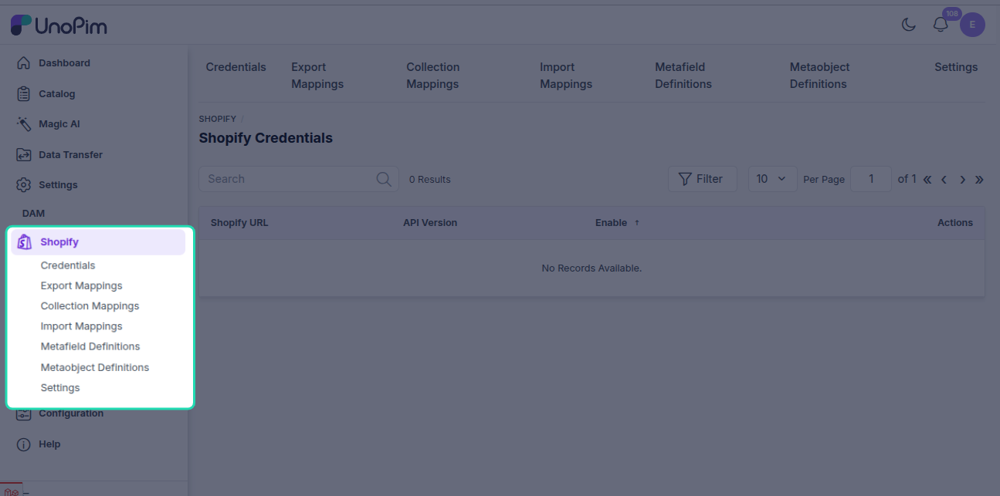
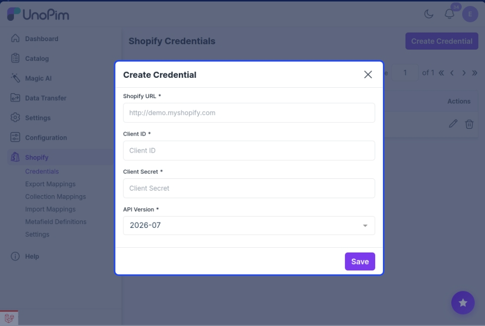
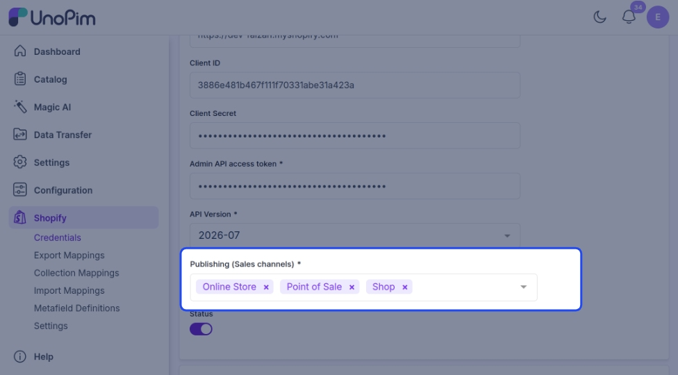
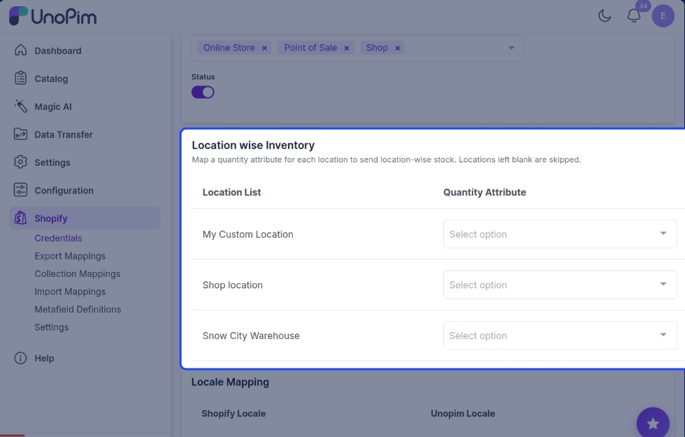

# Setting Up UnoPim Credentials

Once the connector is installed, the next step is to connect your Shopify store to UnoPim. This is done by adding your Shopify credentials inside the UnoPim dashboard.

---

## Step 1 - Open the Shopify Section

After installation, you'll notice a new **Shopify icon** in the left sidebar of your UnoPim dashboard. Click on it to open the connector.

---

## Step 2 - Create New Credentials

Go to the **Credentials** tab and click **Create Credentials**.

Fill in the following details:

| Field | What to enter |
|---|---|
| **Shopify URL** | Your store's permanent `.myshopify.com` address including `https://`, e.g. `https://mystore.myshopify.com` |
| **Client ID** | The Client ID from your app's settings in the Shopify Dev Dashboard |
| **Client Secret** | The Client Secret from the same screen |
| **API Version** | Select `2026-10` (the latest version the connector offers) |

> [!WARNING]
> The URL must be the `.myshopify.com` address, not your custom storefront domain (such as `www.mystore.com`), and it must start with `https://` or `http://`. Any other format is rejected with "Enter your store's .myshopify.com address". Each Shopify URL can be saved only once.

> **Note:** The connector offers API versions **2026-10**, **2026-07**, **2026-04** and **2026-01**. Select **2026-10** unless you have a reason to pin an older version.

Click **Save** once all fields are filled in.

---

## Step 3 - Update the Credential Settings

After saving, you'll be redirected to the credential edit screen. Complete the remaining fields:

**Publishing (Sales Channels)**
Select which Shopify sales channels your products should be published to once exported.

**Status**
Enables or disables the credential. A disabled credential cannot be used by export or import jobs. The status given to exported products is set separately, under **Shopify Status** in [Export Mappings](./attribute-mapping#shopify-status).

If you change the **Shopify URL** later, re-enter the Client Secret (or access token) in the same save.

> **Note:** The **Sales Channels** are fetched directly from your Shopify store. If you don't see them in the dropdown, make sure they have been created in Shopify first before setting up credentials here.

---

## Step 4 - Map Your Locations

Map a quantity attribute (number or decimal type) to each Shopify location to send location-wise stock. Any location you leave blank is skipped during sync.

> [!NOTE]
> Location stock is sent only when a product is first created in Shopify. Later exports of an existing product do not change its inventory.

> **Note:** The **Location List** is fetched directly from your Shopify store. If a location is missing from the list, create it in Shopify first.

---

## Step 5 - Map Your Locales

If your Shopify store supports multiple languages, all available Shopify locales are fetched automatically. You just need to map each Shopify locale to the corresponding locale in UnoPim.

---

## Connecting Multiple Shopify Stores

You can connect **more than one Shopify store** to the same UnoPim instance. Simply repeat the steps above and create a separate set of credentials for each store.

---

## Connecting Through the UnoPim Shopify App

Instead of a custom app, a store can connect through the UnoPim connector app installed from Shopify. The app creates the credential in UnoPim by calling the REST API (`POST` / `PUT /api/v1/shopify/saas/credentials`), so it needs a UnoPim API integration whose role has the **SaaS Credentials** API permission.

- A credential created this way is read-only in UnoPim, except **Publishing (Sales channels)**, the location mapping and the locale mapping.
- Use **Sync** on the credentials list to regenerate the UnoPim integration secret and send it to the app. **Revoke** removes the Shopify connection and deletes the credential from UnoPim.
- While such a credential exists, manual credentials cannot be created ("A SaaS Shopify connection already exists. Manual credentials are disabled.").

---

## Permissions

Admin users whose role is not set to **All** need these permissions under **Settings → Roles**, in the **Shopify** group: **Credentials** (**Create**, **Edit**, **Delete**, and **Catalogs** for Pro), **Export Mappings**, **Collection Mappings**, **Import Mappings**, **Metafield Definitions** (**Create**, **Edit**, **Delete**, **Mass Delete**), **Metaobject Definitions** (**Create**, **Edit** with **Create Entry**, **Edit Entry**, **Delete Entry**, **Delete**, **Mass Delete**) and **Settings**.
