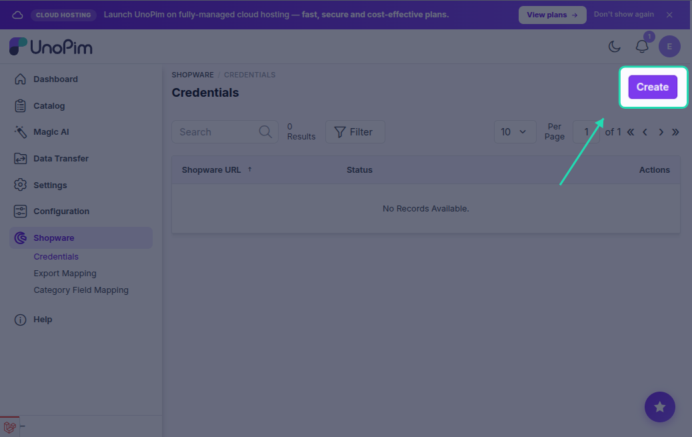
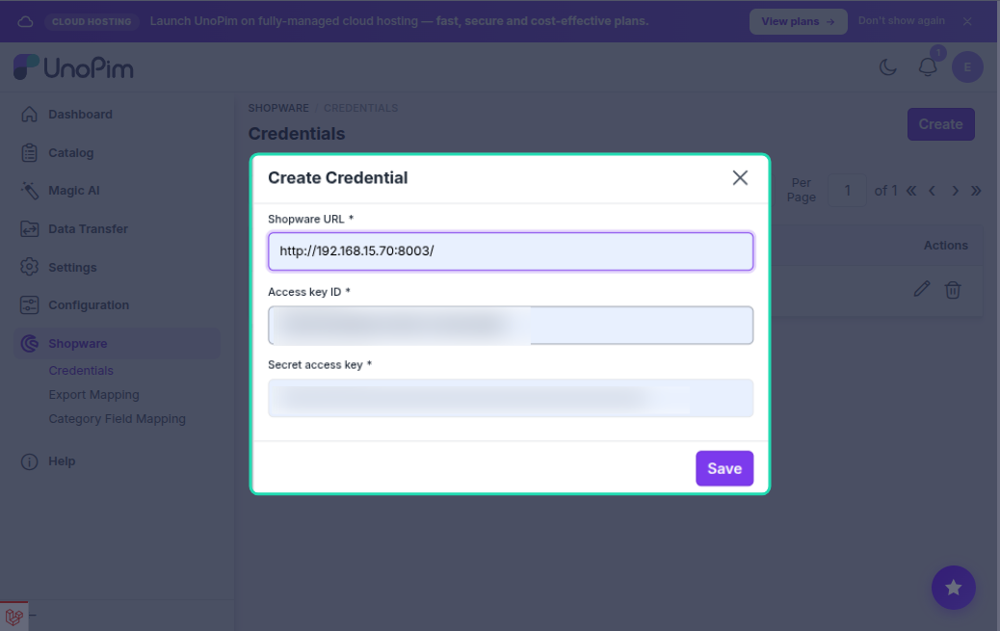
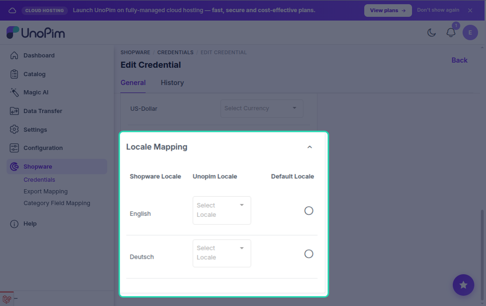
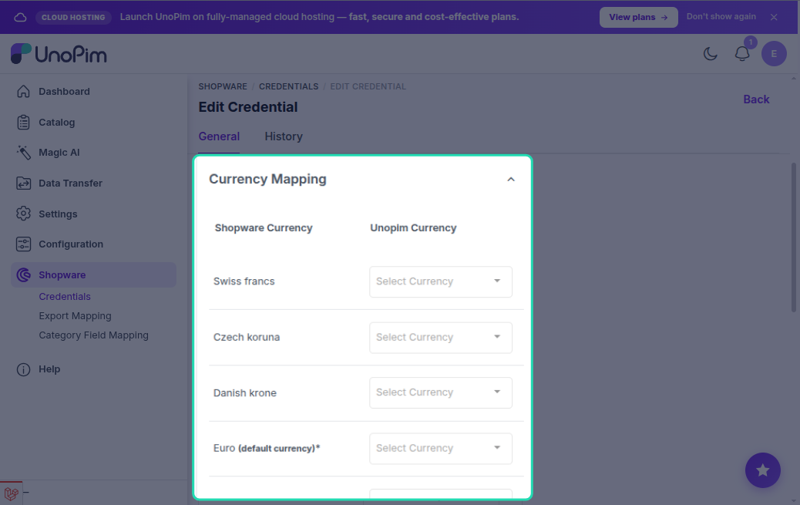

# Setup Credentials in UnoPim

After the connector is installed, the next step is to connect UnoPim to your Shopware store by entering your Shopware API credentials.

Go to **Shopware → Credentials → Create** in the UnoPim left sidebar.

---

## Create a New Credential

Fill in the following fields to add a new Shopware connection.

### General

| Field | Description |
|---|---|
| **Shopware URL** | The base URL of your Shopware instance, e.g. `https://mystore.example.com`. Do not add `/admin` or `/api`; the connector appends `/api/...` itself. A trailing `/` is removed. |
| **Access key ID** | The Access Key ID from the Shopware Integration you created. |
| **Secret access key** | The Secret Access Key from the Shopware Integration. |

> [!NOTE]
> When you save, UnoPim requests an OAuth2 token and reads the Shopware tax list with these keys. The save fails with "The Secret Access Key and/or the Access Key ID is invalid" if the URL is wrong, the keys are wrong, or the integration cannot read taxes.

> [!WARNING]
> Only one credential can exist per Shopware URL. The URL cannot be changed after the credential is saved; create a new credential for a different store URL.

A new credential is saved as active. After saving, the credential opens on its **General** tab, where the remaining settings appear:

| Field | Description |
|---|---|
| **Status** | Only active credentials can be selected in export jobs. |
| **Media Folder Id** | Optional. The ID of a Shopware media folder. Product images uploaded by the export are stored in this folder. Leave empty to use Shopware's default. |

---

## Locale Mapping

After saving the basic credential, you need to map each **UnoPim locale** to the corresponding **Shopware language**.

On the credential edit screen, scroll to the **Locale Mapping** section. The Shopware languages are loaded from your store automatically when the page opens. For each Shopware language shown, select the matching UnoPim locale from the dropdown.

Turn on the **Default Locale** switch on one row — this is used as the base translation language when pushing content to Shopware. At least one locale mapping and a default locale are required to save the credential.

| Field | Description |
|---|---|
| **Shopware Locale** | The language identifier as configured in your Shopware store. |
| **UnoPim Locale** | The locale in UnoPim whose attribute values will be sent for this language. |
| **Default Locale** | The UnoPim locale used for the primary (default) Shopware language. |

> [!NOTE]
> Product exports stop with "The store default locale is not mapped" if the Shopware default language has no UnoPim locale mapped.

---

## Currency Mapping

In the **Currency Mapping** section, map each **Shopware currency** to the corresponding **UnoPim currency**.

This mapping controls which price attribute values are exported for each currency in Shopware.

| Field | Description |
|---|---|
| **Shopware Currency** | The currency as configured in your Shopware store (e.g. EUR, USD). |
| **UnoPim Currency** | The matching currency defined in UnoPim. |

The Shopware currencies are loaded from your store automatically when the page opens.

The Shopware **default currency** must be mapped before any product export job will run successfully.

---

## Managing Multiple Stores

You can create more than one credential — each pointing at a different Shopware store URL. Each export job lets you select which credential (store) to use, so you can manage multiple storefronts from a single UnoPim instance.

Each credential has its own mapping tabs: **Attribute Mapping**, **Custom Field Mapping**, **Other Mapping** and **Category Field Mapping**. Editing one credential's mappings never changes another's. Use the **History** button on the credential to see every change made to it and its mappings.

---

## Credential Grid

All saved credentials are listed in the grid at **Shopware → Credentials**. From there you can:

- **Edit** a credential to update the keys, status, media folder, locale mapping, or currency mapping.
- **Delete** a credential if a store connection is no longer needed. Its mappings are deleted with it.
- Select several credentials to **Update Status** or **Delete** them in bulk.

## Permissions

Admin users whose role is not set to **All** need these permissions under **Settings → Roles**, in the **Shopware → Credentials** group: **Create**, **Edit**, **Delete**, **Mass Update**, **Mass Delete**, **Attribute Mapping**, **Custom Field Mapping**, **Other Mapping** and **Category Field Mapping**. Opening a mapping tab requires its permission.

