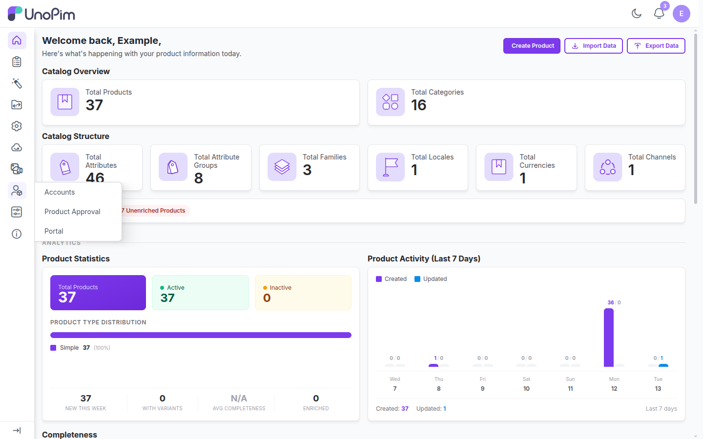

# Installation

Before you start, make sure UnoPim 3.0.0 or higher is installed and working. See the [requirements](./) for the PHP, Composer and Node.js versions.

## Steps

### 1. Copy the extension files

Unzip the Supplier Data Portal package and copy its `packages/` folder into your UnoPim project root, merging it with the existing `packages/` directory. The extension lives in `packages/Webkul/Supplier`.

### 2. Register the service provider

Open `bootstrap/providers.php` and add the provider to the returned array:

```php
use Webkul\Supplier\Providers\SupplierServiceProvider;

return [
    // ...existing providers...
    SupplierServiceProvider::class,
];
```

> [!NOTE]
> This lets Laravel load the extension's routes, views, menus, permissions and configuration when the application starts.

### 3. Add the namespace to Composer

In the root `composer.json`, add the namespace under `autoload.psr-4`:

```json
"autoload": {
    "psr-4": {
        "Webkul\\Supplier\\": "packages/Webkul/Supplier/src"
    }
}
```

### 4. Run the installer

```bash
composer dump-autoload
php artisan supplier:install
```

| Command | What it does |
|---|---|
| `composer dump-autoload` | Regenerates Composer's autoloader so it includes the `Webkul\Supplier` namespace. |
| `php artisan supplier:install` | Runs the extension's migrations, publishes its front-end assets, adds the `supplier` guard to `config/auth.php` and `config/audit.php`, registers the `supplier.web` middleware group in `bootstrap/app.php`, and clears the application cache. |

> [!NOTE]
> The installer also copies two admin view overrides, `resources/views/vendor/admin/components/layouts/sidebar/index.blade.php` and `resources/views/vendor/admin/components/modal/confirm.blade.php`. They replace UnoPim's own sidebar and confirm dialog. If you upgrade UnoPim, re-run `php artisan supplier:install` so these copies match the new version.

The installer stops with a clear message if UnoPim is not installed yet, or if it cannot update one of the configuration files. In that case, make the change it describes by hand and run the command again. It is safe to run more than once.

### 5. Start a queue worker

Supplier imports and exports run as queued jobs. Make sure a queue worker is running, for example:

```bash
php artisan queue:work --queue=default
```

In production, run the worker under a process manager such as Supervisor, the same way you do for UnoPim's own import and export jobs.

If queue workers were already running before you installed the extension, restart them so they load its job classes:

```bash
php artisan queue:restart
```

Password reset emails for suppliers are sent with UnoPim's mail settings (`MAIL_*` in `.env`). Configure mail before suppliers use **Forget Password?**.

### 6. Build the Elasticsearch index (only if Elasticsearch is enabled)

When `ELASTICSEARCH_ENABLED=true`, supplier products are stored in a separate index named `<prefix>_supplier_products`. New and changed products are indexed automatically. Run this once after installation, after you enable Elasticsearch, or when the supplier product grids look out of date:

```bash
php artisan supplier:product:index
```

| Option | What it does |
|---|---|
| `--fresh` | Drops the supplier index and rebuilds it from the database. |
| `--workers=N` | Indexes in `N` parallel processes. Default `1`. |

### 7. Rebuild the front-end assets (optional)

The extension ships with built assets, and `supplier:install` publishes them for you. If icons or styles are missing after installation, re-publish the shipped assets:

```bash
php artisan vendor:publish --tag=supplier-package --force
```

Rebuild the assets only if you change the extension's CSS or JavaScript:

```bash
cd packages/Webkul/Supplier
npm install
npm run build
```

`npm run build` writes directly to `public/themes/supplier/default/build`.

> [!WARNING]
> `vendor:publish --tag=supplier-package --force` and `supplier:install` overwrite that folder with the shipped build. To keep your changes, also copy the build output into `packages/Webkul/Supplier/publishable/supplier/default/build`.

### 8. Check the installation

- Open `https://your-domain.com/supplier/login`. You should see the supplier sign-in page.
- Sign in to the UnoPim admin panel. A **Supplier** menu with **Accounts**, **Product Approval** and **Portal** should appear in the sidebar.


