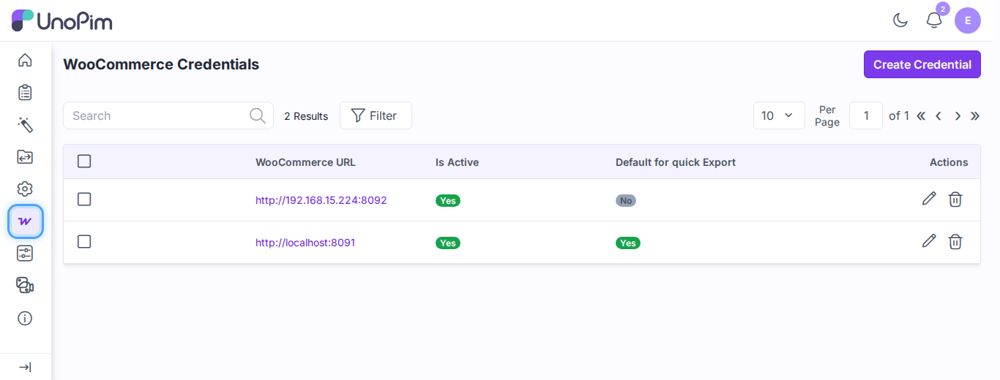
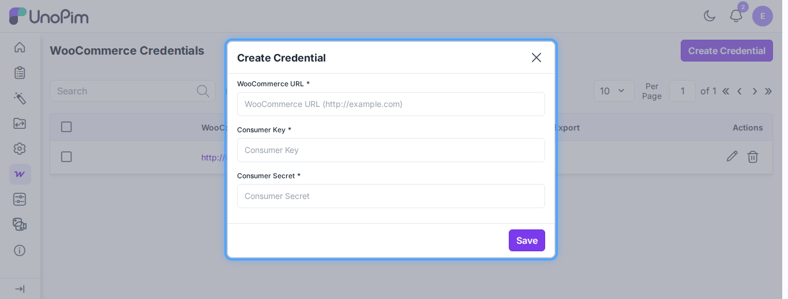
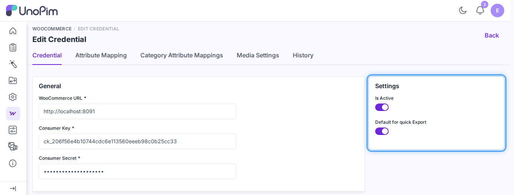
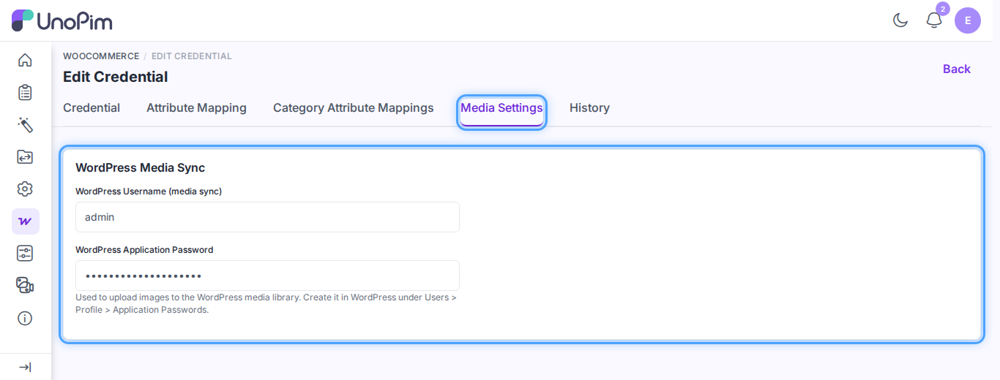

# Setup Credentials in UnoPim

Once the UnoPim WooCommerce Connector is installed, it becomes available in the left-side menu of the UnoPim admin panel.

From there, go to **WooCommerce > Credentials** and click **Create Credential** to add a new WooCommerce account and connect it with UnoPim.

This credential setup allows UnoPim to communicate securely with your WooCommerce store for product, category, attribute, and variation synchronization.

## Create a New Credential

While creating a new credential, the admin needs to enter the following details:

### General Details

- **WooCommerce URL**: Enter the base URL of your WordPress site, starting with `http://` or `https://`, e.g. `https://shop.example.com`. Do not add `/wp-json` or `/wp-admin`; the connector appends `/wp-json/wc/v3/` itself. Only one credential can exist per URL.
- **Consumer Key**: Enter the Consumer Key generated from WooCommerce.
- **Consumer Secret**: Enter the Consumer Secret generated from WooCommerce.

Click **Save** to create the credential. UnoPim calls the WooCommerce REST API with these keys before saving; if the store answers 404 the error is "The provided url is invalid", otherwise the WooCommerce error is shown on the key field.

## Settings

After the credential is created, open it from the credentials list to access the following configuration options:

- **Is Active**: This option is enabled by default when a new credential is created. You can enable or disable the credential at any time by toggling this option.
- **Default for Quick Export**: Enable this option if you want to use the credential for WooCommerce quick export jobs. The same credential is the only one used by **Auto Sync**.

> **Note:** Only one credential can be set as the default for quick export at a time. Enabling it on one credential turns it off on the others.

## Media Settings

The edit page also has a **Media Settings** tab (alongside **Attribute Mapping**, **Category Attribute Mappings** and **History**). Fill in the **WordPress Media Sync** details so UnoPim can upload images to the WordPress media library:

- **WordPress Username (media sync)**: The WordPress user the application password belongs to.
- **WordPress Application Password**: The application password created in WordPress under **Users > Profile > Application Passwords**. It must be the 24 letters or digits WordPress generates (spaces allowed), not the user's login password. UnoPim checks the pair with WordPress when you save.

## Navigation Flow

Follow this path in the UnoPim admin panel:

`WooCommerce > Credentials > Create Credential`

## Permissions

Admin users whose role is not set to **All** need these permissions under **Settings > Roles**, in the **WooCommerce > WooCommerce Credentials** group: **Create Credential**, **Edit Credential**, **Delete Credential**, **Update Credential**, **Attribute Mapping**, **Update Attribute Mapping**, **Mass Edit Credential** and **Mass Delete Credential**.

