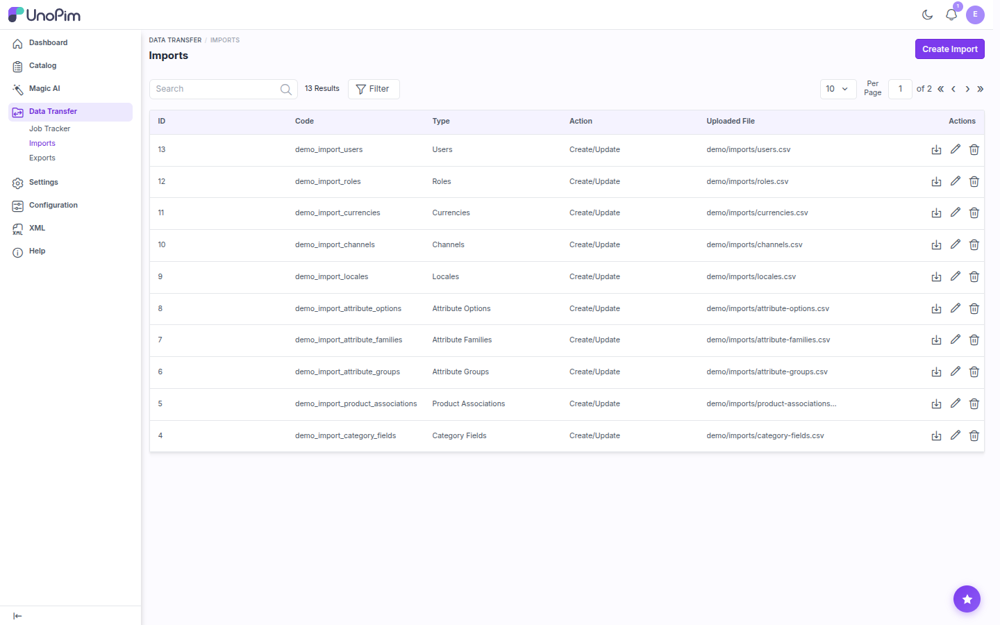
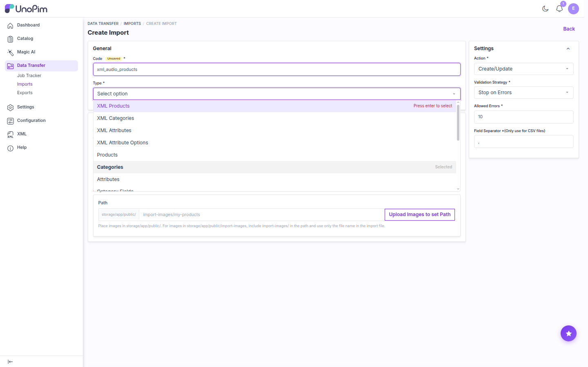
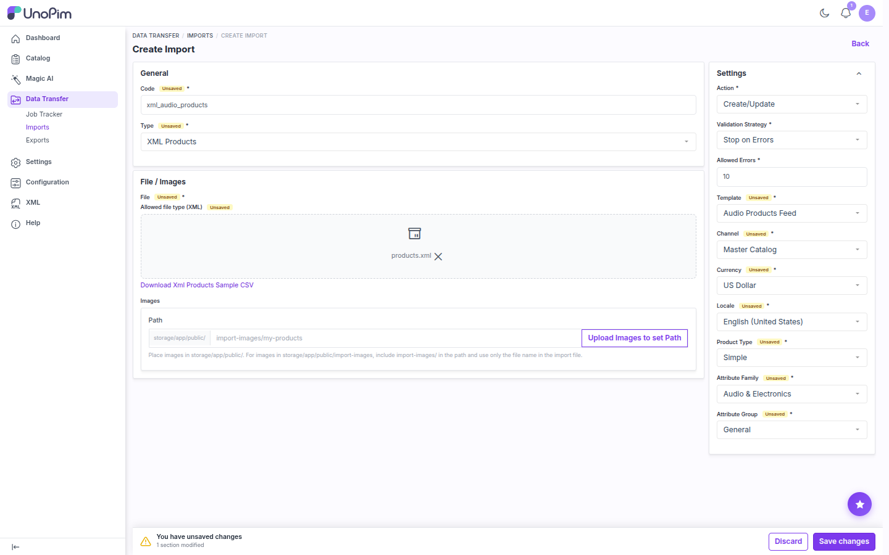
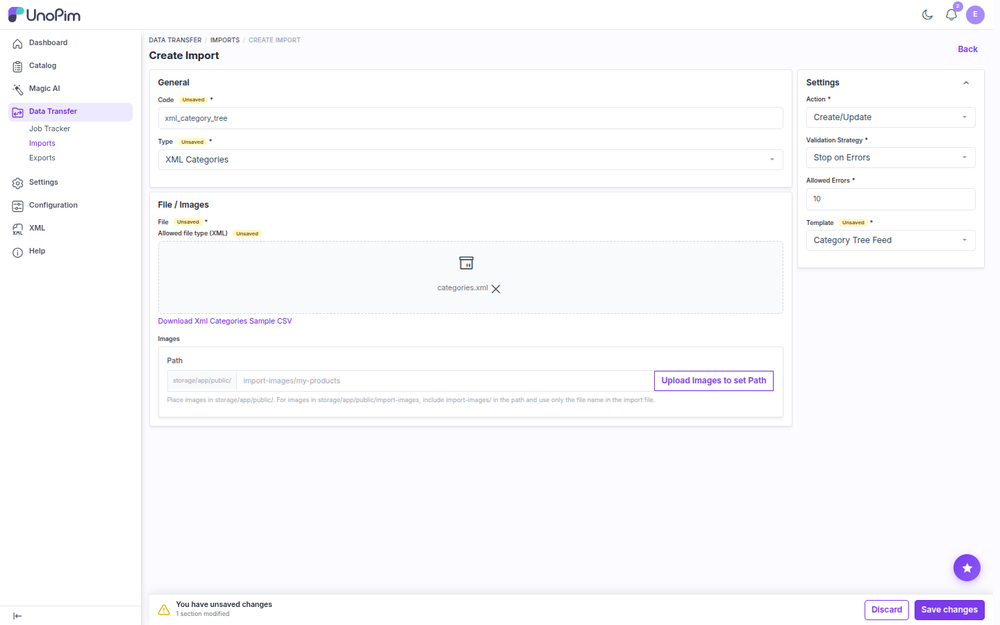
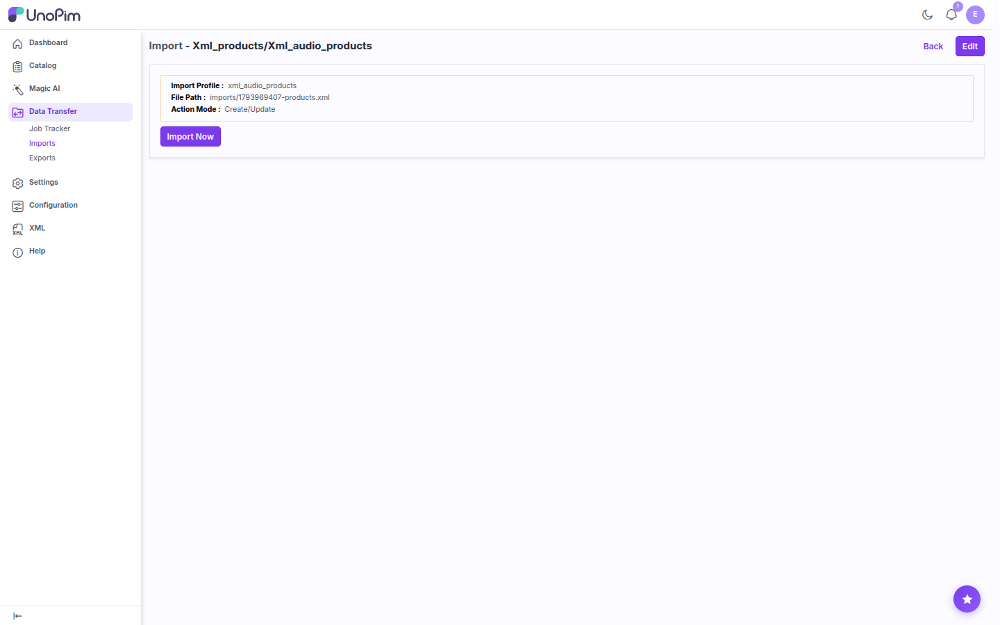
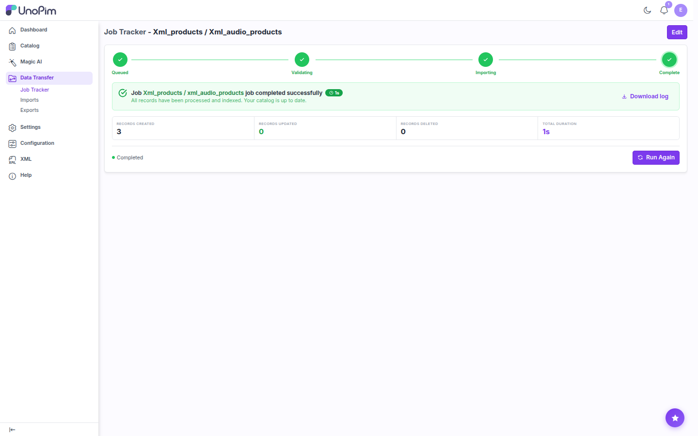
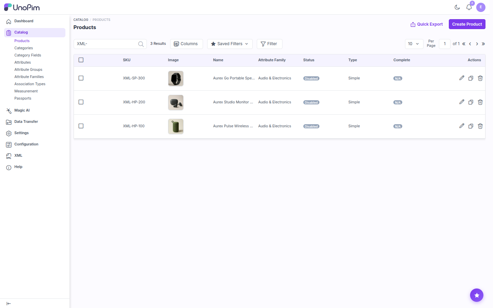
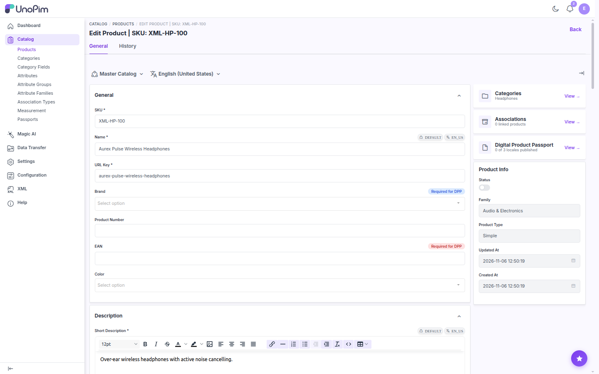
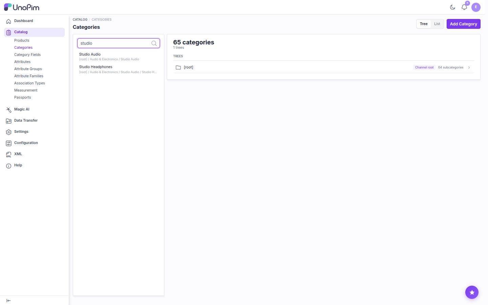
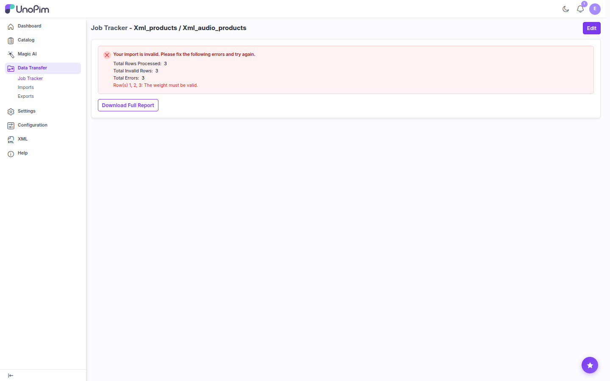

# Running an XML Import

Once you have an **Enabled** Mapping Template, you can import XML files through UnoPim's standard **Data Transfer** pipeline. The connector adds four import types:

| Import Type | Imports | Filters |
|---|---|---|
| **XML Products** | Products into your catalog | Template, Channel, Currency, Locale, Product Type, Attribute Family, Attribute Group |
| **XML Categories** | The category tree | Template |
| **XML Attributes** | Attribute definitions | Template |
| **XML Attribute Options** | Options for select / multiselect attributes | Template |

> [!TIP]
> When you import a full catalog, run the jobs in this order: **XML Attributes → XML Attribute Options → XML Categories → XML Products**. Options need their attribute, and products need their attributes, options, and categories.

## Step 1: Create the Import Profile

1. Go to **Data Transfer → Imports** and click **Create Import**.

2. In **General**, enter a unique **Code** (for example `xml_audio_products`) and choose an XML **Type**.

3. In **File / Images**, upload the XML data file under **File** (*Allowed file type (XML)*). This is your actual data, with the same structure as the sample file you used for the template. It can contain any number of records.

4. In **Settings**, set the standard import options and the XML filters.

### XML Products

| Setting | Description |
|---|---|
| **Action** | **Create/Update** adds new products and updates existing ones, matched by SKU. |
| **Validation Strategy** | **Stop on Errors** rejects the file if a row is invalid. **Skip Errors** imports the valid rows and reports the rest. |
| **Allowed Errors** | How many errors to tolerate when skipping errors. |
| **Template** | An enabled **XML Products** template. |
| **Channel** | The channel for channel-specific values. |
| **Currency** | The currency for price attributes. |
| **Locale** | The locale for localizable values. |
| **Product Type** | **Simple** or **Variant Group**. |
| **Attribute Family** | The family given to every imported product. |
| **Attribute Group** | The attribute group within that family. |

All XML Products filters are required.

> [!NOTE]
> The **Images → Path** field is only for local image files. With XML, media is usually given as URLs, so you can leave it empty.

### XML Categories, XML Attributes, XML Attribute Options

These types only need a **Template**. The locale and other values come from the fields mapped in the template.

> [!NOTE]
> The **Template** dropdown only lists **enabled** templates of the selected import type. If yours is missing, check its Import Type and status under **XML → Mapping Templates**.

5. Click **Save changes**.

## Step 2: Run the Import

After you save, the import profile summary opens. It shows the profile code, the stored file path, and the action mode. Click **Import Now**.

The Job Tracker opens and moves through **Queued → Validating → Importing → Complete**. When the job finishes, it shows how many records were created, updated, and deleted.

To run the same profile again with a new file, click **Edit** on the profile, replace the file, save, and click **Import Now**. You can also click **Run Again** in the Job Tracker to re-run the same file.

## Step 3: Check the Results

Imported products appear under **Catalog → Products** with their images downloaded from the URLs in the XML:

Open a product to check its values and category assignment:

> [!NOTE]
> The XML product import doesn't set the product **Status**, so new products are created **Disabled**. Enable them from the product page, or select several in the grid and use the mass action to enable them.

Categories imported with **XML Categories** appear in **Catalog → Categories** under the parent you gave:

## Errors and the Error Report

If rows fail validation, the Job Tracker lists the rows and the reason for each, for example *"Row(s) 1, 2, 3: The weight must be valid."*. Click **Download Full Report** to get every failed row with its error message. Fix the XML file and run the import again.

## Troubleshooting

| Problem | What to check |
|---|---|
| The job stays **Queued** | No queue worker is running. Start one with `php artisan queue:work` and run `php artisan queue:restart` after code changes. |
| The template isn't in the **Template** dropdown | It's disabled, its mapping was never saved, or it has a different Import Type. |
| *"The XML file is not well-formed"* | Fix the file. Often a closing tag is missing, or HTML or `&` isn't wrapped in `CDATA`. |
| *"The following required attributes are not mapped"* | Map the listed attributes in the template, or give them a default value. |
| A select value isn't saved | Make sure the XML holds the option **code**, not the label, and only one value. Map multi-value tags to a multiselect attribute. |
| Media isn't imported | The URL must be public and return the right file type (an image for image and gallery attributes). |

## Sample XML Files

Each import type has a downloadable sample:

- Click **Download sample XML** in the **Create Template** dialog. The sample changes with the selected Import Type.
- Or use the download link under the file upload on the **Create Import** form.

The samples are also published to `storage/app/public/data-transfer/samples/` (`products.xml`, `categories.xml`, `attributes.xml`, `attribute-options.xml`).
