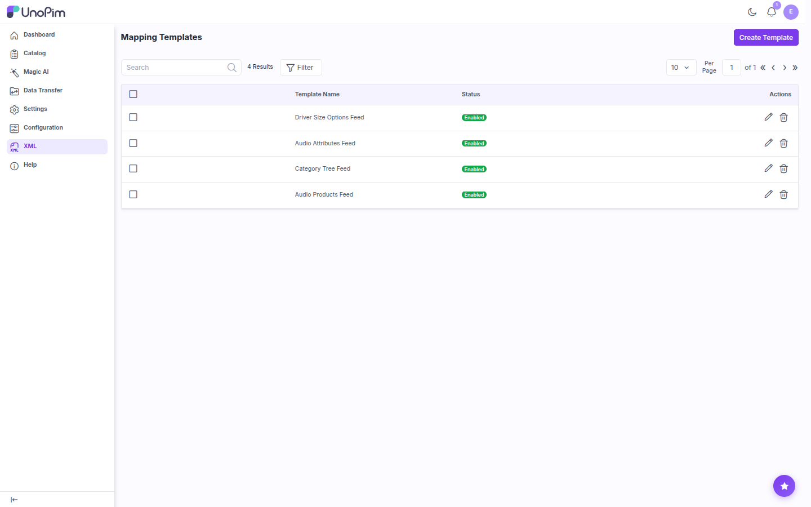

# UnoPim XML Connector

The **UnoPim XML Connector** imports data into UnoPim from any XML file. You describe how your XML maps to UnoPim once, in a reusable **Mapping Template**. After that, you run an import job with that template whenever you get a new file.

The connector imports four entity types. Each one has its own templates and its own import job type:

| Entity Type | Imports |
|---|---|
| **XML Products** | Products into your catalog |
| **XML Categories** | The category tree |
| **XML Attributes** | Attribute definitions |
| **XML Attribute Options** | Options for select / multiselect attributes |



## How It Works

```
XML → Create Template: pick the Import Type, upload a sample XML, click Validate
        ↓
Choose the Multiproduct Tagname (wrapper) and Product Tagname (one record) → Save
        ↓
Map each XML field tag to a UnoPim field → Save changes (the template is now Enabled)
        ↓
Data Transfer → Imports → Create Import
        ↓
Pick the XML import type, upload the XML data file, choose the template and filters
        ↓
Save changes → Import Now → follow the progress in the Job Tracker
```

The template only stores the structure and the field mapping. The XML data file is uploaded on the import job, so one template can drive imports of many files with the same structure.

## Features

- **Four entity types**: products, categories, attributes, and attribute options, each with its own template and import job.
- **Reusable Mapping Templates**: upload a sample XML file, map its tags to UnoPim fields, and reuse the template in any number of import jobs.
- **Auto-suggested mapping**: when an XML tag matches a UnoPim attribute code or name, the editor selects it for you.
- **Default attribute value**: set a fixed value for a mapped field, applied to every record instead of the XML value.
- **Any XML structure**: choose the record tag and the wrapper tag from the tags found in your file.
- **Full attribute mapping for products**: text, textarea, select, multiselect, boolean, price, date, image, gallery, and file attributes.
- **Category assignment**: map an XML tag to the product's category. Missing categories are created automatically.
- **Media from URL**: image, gallery, and file attributes are downloaded from the URLs in the XML file.
- **Multi-value delimiter**: comma, semicolon, pipe, tab, or colon.
- **Validation before import**: malformed XML, or XML that doesn't match the template, is rejected before the batch runs.
- **Entity-scoped template picker**: each import type only lists enabled templates of the same entity type.
- **Mass actions**: delete templates or update their status in bulk from the listing.
- **Error report**: failed rows are listed in the Job Tracker with a downloadable full report.
- **Change history**: every template change is versioned in the template's **History** tab.
- **Role-based access control**: separate permissions for create, edit, update, rename, delete, mass update, mass delete, and toggle status.

## Requirements

| Requirement | Version |
|---|---|
| **UnoPim** | 3.0.x or 3.1.x (screenshots in this guide are from UnoPim 3.1.3) |
| **PHP** | 8.4 (the connector supports 8.3 to 8.4.x, but UnoPim 3.1 itself needs 8.4.1 or higher) |
| **Laravel** | 12 or 13 (as shipped with your UnoPim version) |
| **Queue worker** | A running `php artisan queue:work` process. Imports run as queued jobs. |

## In This Guide

- [Installation](./installation): add the package and run the installer.
- [Mapping Templates](./mapping-templates): create a template and map XML fields to UnoPim.
- [Running an Import Job](./import-job): import products, categories, attributes, and options.
- [Support](./support)
