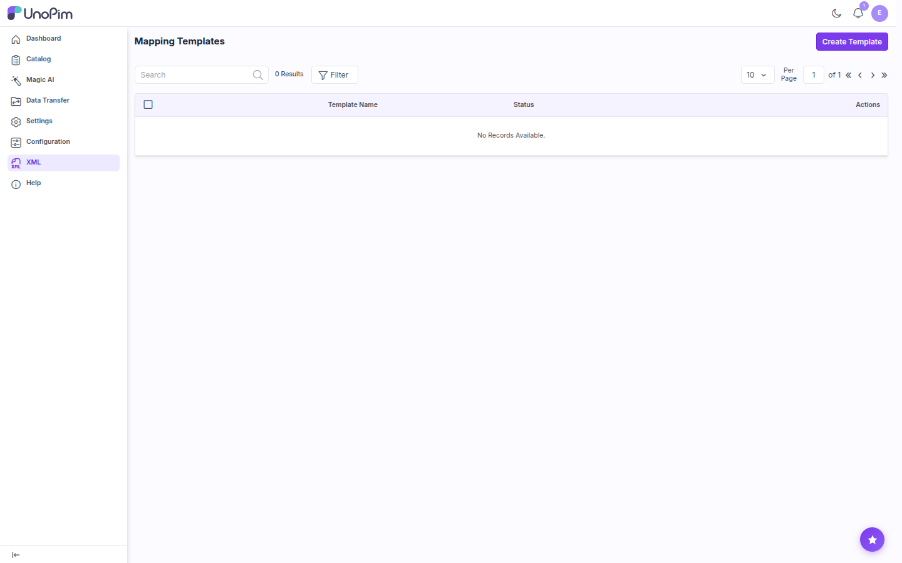
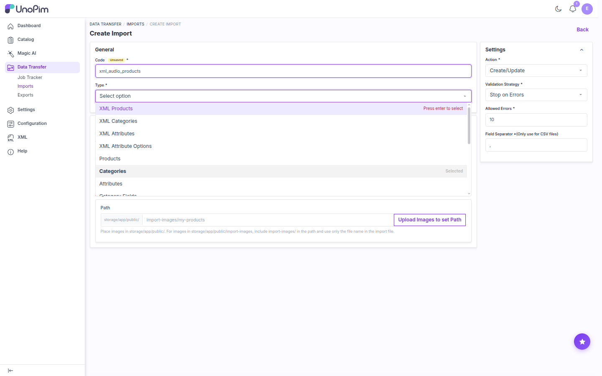

# Installation

Follow these steps to install the UnoPim XML Connector on UnoPim 3.x. You need terminal access to the server.

## Step 1 - Add the Package Files

Unzip the extension. Inside you'll find a `packages` folder. Merge it into the **root directory** of your UnoPim project so that the package ends up at:

```text
packages/Webkul/XmlConnector/
```

## Step 2 - Register the Service Provider

Open `bootstrap/providers.php` and add the connector's service provider:

```php
use Webkul\XmlConnector\Providers\XmlConnectorServiceProvider;

return [
    // ...existing providers...
    XmlConnectorServiceProvider::class,
];
```

> [!NOTE]
> This registers `XmlConnectorServiceProvider` so the connector can load its routes, views, translations, menu, ACL, and the four XML importers when UnoPim starts.

## Step 3 - Update Composer Autoload

Open `composer.json` and add this line under `autoload > psr-4`:

```json
"Webkul\\XmlConnector\\": "packages/Webkul/XmlConnector/src"
```

## Step 4 - Run the Installer

Refresh the Composer autoloader, then run the connector's installer:

```bash
composer dump-autoload
php artisan xml-connector:install
```

The installer runs the database migrations, publishes the connector's prebuilt assets to `public/themes/xml-connector`, and clears the application cache.

Then restart the queue worker so it loads the new importers:

```bash
php artisan queue:restart
```

> [!IMPORTANT]
> XML imports run as queued jobs. Make sure a worker is running, for example `php artisan queue:work --queue=system,default`. If no worker is running, imports stay in the **Queued** state.

| Command | Purpose |
|---|---|
| `composer dump-autoload` | Regenerates the autoloader so the `Webkul\XmlConnector` namespace is found. |
| `php artisan xml-connector:install` | Runs the migrations (creates the `template_configuration` table and adds its `entity_type` column), publishes the assets, and clears the cache. |
| `php artisan queue:restart` | Signals the queue workers to reload the latest code once their current job is done. |

::: details Manual alternative to the installer
If you prefer to run each step yourself:

```bash
php artisan migrate
php artisan vendor:publish --tag=xml-connector-package --force
php artisan optimize:clear
php artisan queue:restart
```

The package ships with compiled assets, so you don't need `npm install` or `npm run build`.
:::

## Verify the Installation

Log in to the UnoPim admin panel. An **XML** entry now appears in the left sidebar. Click it to open the **Mapping Templates** page.



Then go to **Data Transfer → Imports → Create Import** and open the **Type** dropdown. The four XML import types appear at the top of the list.



If the menu entry or the import types are missing, run `php artisan optimize:clear` and reload the page.

## Upgrading from an Earlier Version

1. Replace `packages/Webkul/XmlConnector/` with the new version.
2. Run `composer dump-autoload` and `php artisan xml-connector:install`.
3. Run `php artisan queue:restart`.

Templates created before version 1.3.0 are migrated to the **XML Products** entity type automatically.
