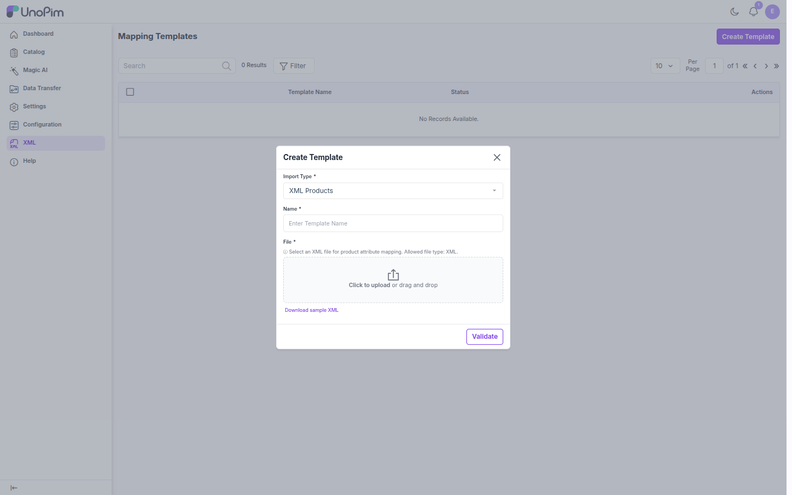
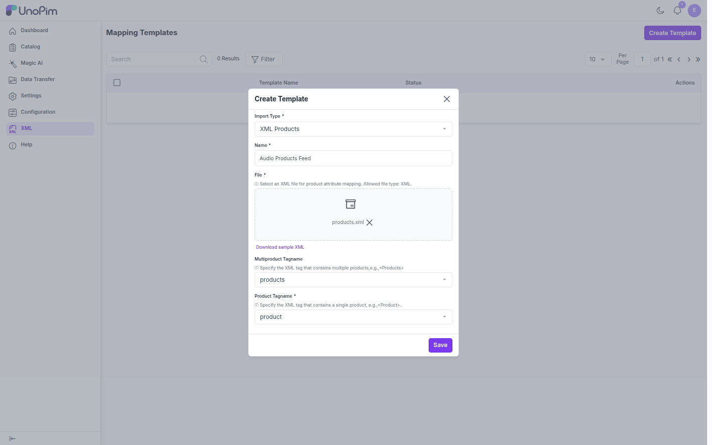
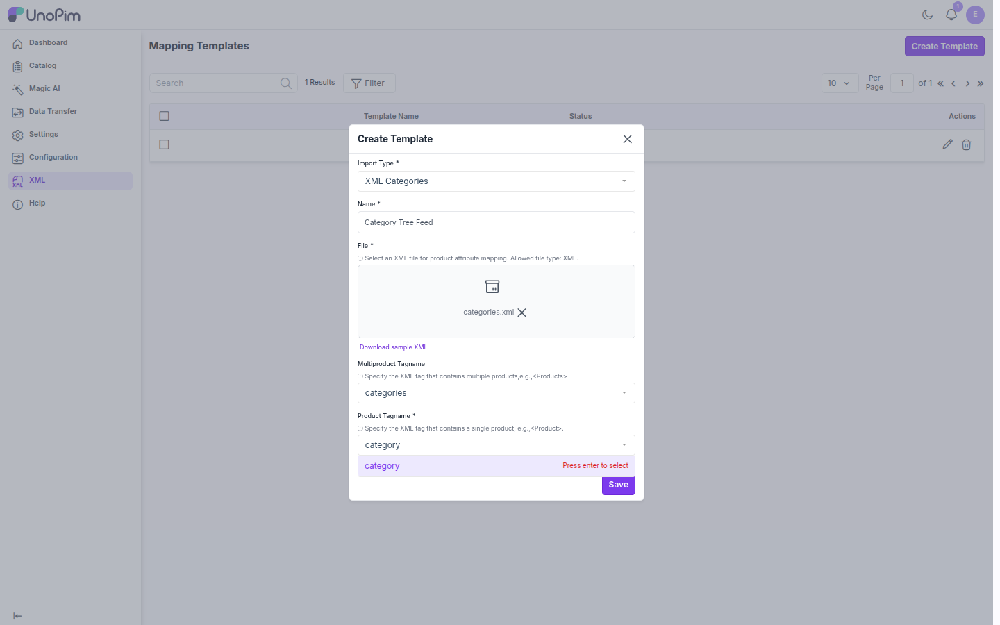
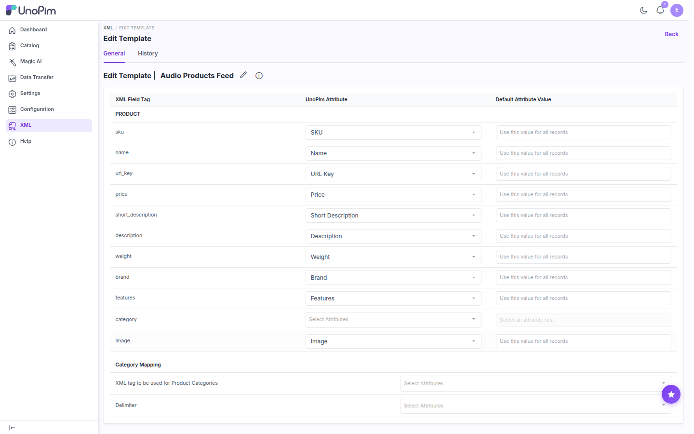
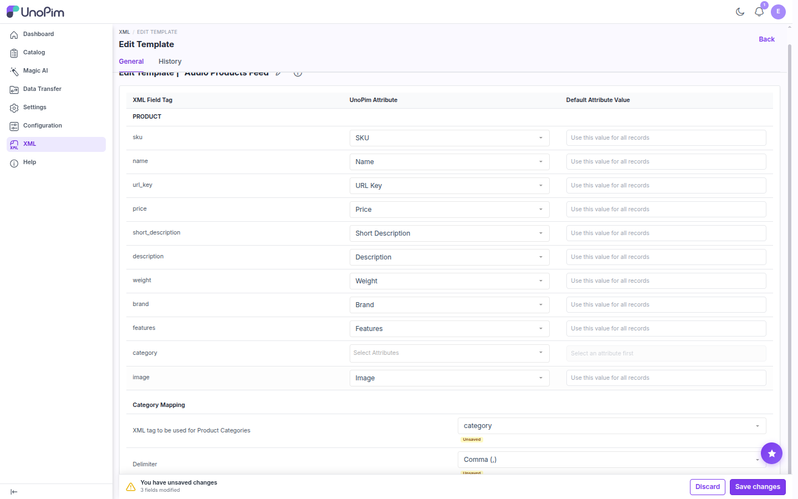
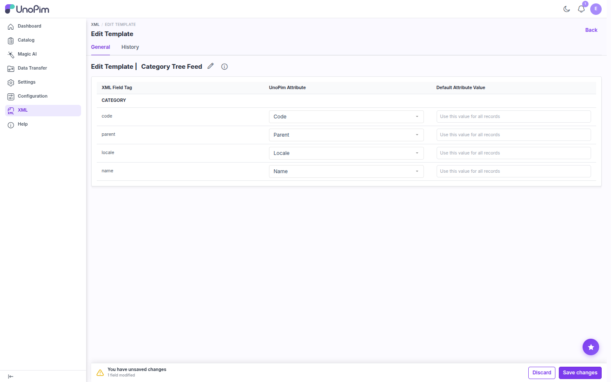
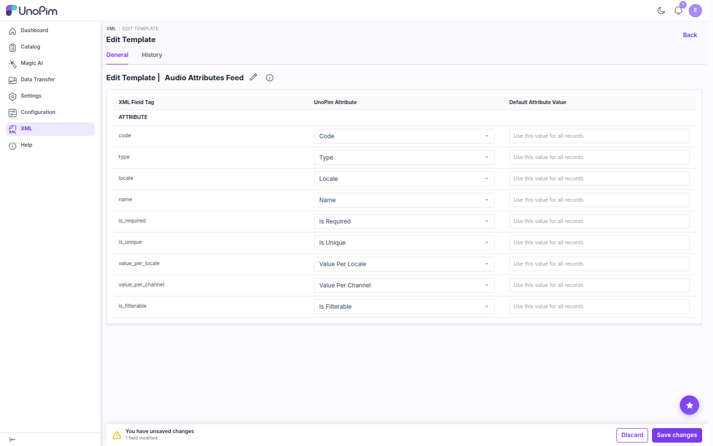
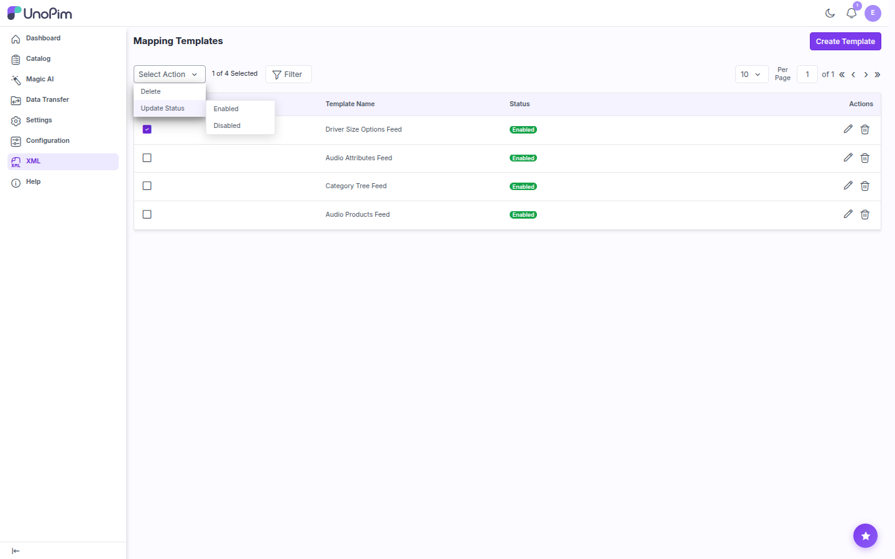
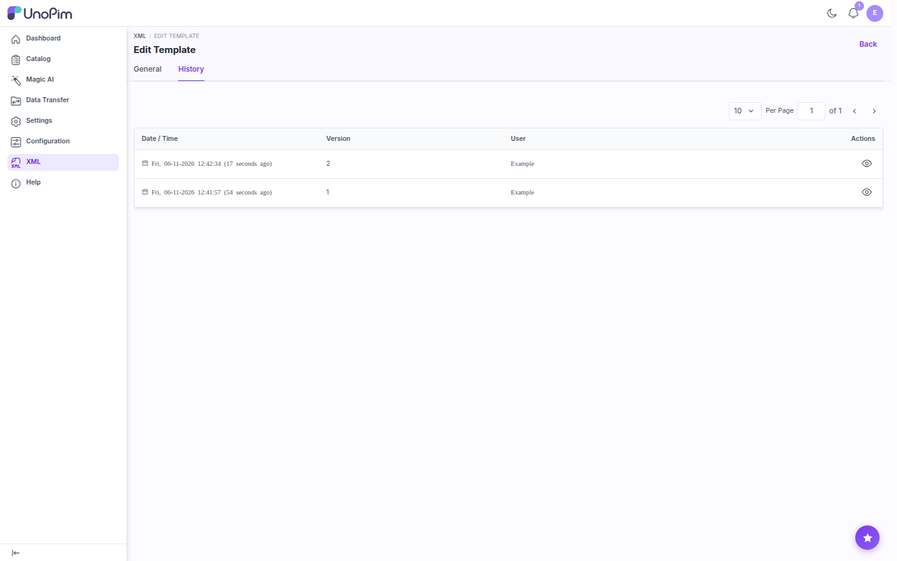

# Mapping Templates

A **Mapping Template** tells the XML Connector how to read your XML file: which tag wraps a single record, and which UnoPim field each XML tag goes to. You create a template once and reuse it in as many import jobs as you need.

Every template belongs to one entity type, chosen when you create it. It only appears in the import job of that type:

| Import Type | Imports |
|---|---|
| **XML Products** | Products into your catalog |
| **XML Categories** | The category tree |
| **XML Attributes** | Attribute definitions |
| **XML Attribute Options** | Options for select / multiselect attributes |

Click **XML** in the left sidebar to open the **Mapping Templates** page.

## Step 1: Prepare a Sample XML File

The connector reads the tags of your file to build the mapping editor, so start with a small file that has the same structure as your real data. Here is the product file used in this guide:

```xml
<?xml version="1.0" encoding="utf-8"?>
<products>
    <product>
        <sku>XML-HP-100</sku>
        <name>Aurex Pulse Wireless Headphones</name>
        <url_key>aurex-pulse-wireless-headphones</url_key>
        <price>149.00</price>
        <short_description>Over-ear wireless headphones with active noise cancelling.</short_description>
        <description><![CDATA[<p>40-hour battery, Bluetooth 5.3 and fast charging.</p>]]></description>
        <weight>0.31</weight>
        <brand>aurex</brand>
        <features>bluetooth_5,noise_cancelling,fast_charge</features>
        <category>headphones</category>
        <image>https://cdn.example.com/products/aurex-pulse.webp</image>
    </product>
    <!-- more <product> records -->
</products>
```

- `<products>` is the **wrapper** tag (the *Multiproduct Tagname*).
- `<product>` is the **record** tag (the *Product Tagname*). Each `<product>` becomes one row in the import.
- Wrap HTML or special characters in `<![CDATA[ ... ]]>`.

> [!TIP]
> Click **Download sample XML** in the Create Template dialog to get a starter file for the selected import type.

## Step 2: Create the Template

1. On the **Mapping Templates** page, click **Create Template**.
2. Fill in the dialog:

| Field | Description |
|---|---|
| **Import Type** | What this template imports: **XML Products**, **XML Categories**, **XML Attributes**, or **XML Attribute Options**. This sets which UnoPim fields the mapping editor offers. Default: **XML Products**. |
| **Name** | A unique name for the template, such as `Audio Products Feed`. |
| **File** | Your sample XML file. Only `.xml` files are accepted. |



3. Click **Validate**. The connector checks that the file is well-formed XML and reads its tags. Two more fields then appear:

| Field | Description |
|---|---|
| **Multiproduct Tagname** | The wrapper tag that holds all records, for example `products`. |
| **Product Tagname** (required) | The tag that holds one record, for example `product`. |

Both are dropdowns filled with the tags found in your file.



4. Click **Save**. The connector reads one record and opens the mapping editor.

The same wrapper/record idea applies to every import type. For example, a categories file uses `categories` and `category`:



> [!NOTE]
> If the file is malformed, Validate shows an error such as *"The XML file is not well-formed: … (line N)"*. Fix the file and upload it again.

## Step 3: Map XML Fields to UnoPim

The mapping editor has three columns:

| Column | Description |
|---|---|
| **XML Field Tag** | Every tag found inside one record of your sample file. |
| **UnoPim Attribute** | The UnoPim field to import this tag into. The editor pre-selects a field when its code or name matches the tag. |
| **Default Attribute Value** | Optional fixed value for every record. See [Default Attribute Value](#default-attribute-value). |



Check the suggestions, change any that are wrong, and leave tags you don't want to import set to **Select Attributes**. Then click **Save changes** in the bar at the bottom of the page.

> [!IMPORTANT]
> A new template is only **Enabled** after you save its mapping for the first time. Until then it doesn't appear in any import job.

Every required field must be mapped, or given a default value, before you can save. Otherwise the editor lists the missing fields, for example *"The following required attributes are not mapped: …"*.

The fields you can map depend on the import type.

### XML Products

Map tags to any UnoPim product attribute. The attributes that are required in your catalog (for example `sku`, `name`, `url_key`) must be mapped. How values are read:

| Attribute type | XML value |
|---|---|
| Text, textarea, price, date, boolean | The tag value as is. HTML in textareas should be inside `CDATA`. Price is saved in the import job's **Currency**. |
| Select | One option **code**, for example `aurex`. A value that holds several options is skipped with a warning. Map it to a multiselect attribute instead. |
| Multiselect | Option codes separated by the template's **Delimiter**, for example `bluetooth_5,fast_charge`. Missing options are created automatically. |
| Image, gallery, file | A public URL (or several URLs for a gallery). The file is downloaded during import. |

> [!WARNING]
> **Measurement attributes** (such as `weight`) don't import correctly with UnoPim 3.1 yet. A `unit,value` value like `KILOGRAM,0.31` fails validation (*"The weight must be valid."*). A plain number passes validation but isn't saved. Set measurement values in UnoPim, or with a regular CSV/XLSX import, until this is fixed.

The import job settings supply the channel, locale, product type, and family, so you don't need tags for them.

#### Category Mapping (XML Products only)

Below the attribute rows, a **Category Mapping** section has two settings:

| Setting | Description |
|---|---|
| **XML tag to be used for Product Categories** | The tag that holds the product's category, for example `category`. The value is turned into a category code (lowercase, non-alphanumeric characters become `_`). If no category has that code, the connector creates one. |
| **Delimiter** | The separator for multi-value fields: **Comma (,)**, **Semicolon (;)**, **Pipe (\|)**, **Tab (\t)**, or **Colon (:)**. Default: comma. |



### XML Categories



| Field | Required | Description |
|---|---|---|
| `code` | Yes | Unique category code |
| `parent` | Yes | Code of the parent category, for example `root` for a top-level category |
| `locale` | Yes | Locale of the localizable values, such as `en_US` |
| `name` and other category fields | | Any active category field in your UnoPim installation |

### XML Attributes



| Field | Required | Description |
|---|---|---|
| `code` | Yes | Unique attribute code |
| `locale` | Yes | Locale of the attribute label |
| `type` | | Attribute type: `text`, `textarea`, `select`, `multiselect`, `boolean`, `price`, `date`, `image`, and so on |
| `name` | | Attribute label |
| `is_required`, `is_unique`, `value_per_locale`, `value_per_channel`, `is_filterable`, `enable_wysiwyg`, `position`, `swatch_type`, `validation`, `regex_pattern`, `ai_translate` | | Attribute settings. Use `true` / `false` for flags. |

### XML Attribute Options


| Field | Required | Description |
|---|---|---|
| `attribute_code` | Yes | Code of the select / multiselect attribute the option belongs to. The attribute must exist. |
| `code` | Yes | Unique option code |
| `locale` | Yes | Locale of the option label |
| `label` | | Display label |
| `sort_order` | | Position in the option list |
| `swatch_value` | | Color code or image value for swatch attributes |

### Default Attribute Value

Use this column when a field should get the same value for every record, for example a fixed `brand` or `tax_category_id`.

1. Select a UnoPim attribute on the row. The **Default Attribute Value** input is disabled until you do (*"Select an attribute first"*).
2. Type the value. It's applied to every record, and the row's XML value is ignored.

Leave it empty to read the value from the XML. A required field counts as covered when it's either mapped or has a default value.

## Rename a Template

On the mapping editor, click the **pencil** icon next to the template name. Type the new name and confirm with the checkmark.

## Enable / Disable Templates

The **Status** column on the listing shows **Enabled** or **Disabled**. Only enabled templates appear in import jobs.

To change the status, select one or more templates with the checkboxes, then choose **Select Action → Update Status → Enabled / Disabled**.



> [!WARNING]
> If you disable a template that an import job uses, that job fails the next time it runs.

## Delete Templates

- **One template**: click the **trash** icon in its row.
- **Several templates**: select them, then choose **Select Action → Delete**.

Deleting a template doesn't affect imports that already finished. Import jobs that still use it will fail on their next run.

## Template History

Open a template and click the **History** tab. Each save creates a new version with its date, version number, and user. Click the **eye** icon to see what changed.



## Next Step

[Run an import job](./import-job) with your template.
